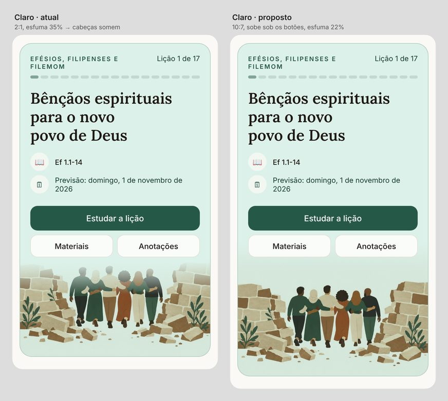
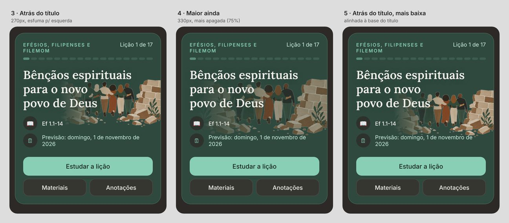

# Destaque do Início: capa recortada no cartão

> **Situação (2026-10-28):** decidido em protótipo, não implementado. O PR #84 (`01713f7`) fez a primeira versão da capa fundida ao cartão; este documento corrige o que ficou ruim no celular.

## O problema (observado no celular, lição 1 de Efésios)

- **Tema claro:** a cena vai para baixo dos botões num recorte 2:1 preso embaixo, esfumando nos primeiros 35%. As capas são quadradas, com o céu vazio em cima e a cena na metade de baixo. Por isso as cabeças caem justamente na faixa esfumada e somem.
- **Tema escuro:** a capa aparece como miniatura emoldurada ao lado do título (`LessonCover`, `dark:block`). O fundo papel claro da ilustração vira um "adesivo" dentro do cartão escuro.



## Decisão

**Uma versão da capa sem o fundo papel ("recorte")**, gerada no backend no upload e aparada até a cena. Com ela:

- **Escuro (opção 3 do protótipo):** a cena fica grande, atrás da parte direita do título, sangrando até a borda direita do cartão e esfumando para a esquerda. O fundo é a própria cor do cartão.
- **Claro:** a cena fica embaixo dos botões, inteira. Usar o recorte também aqui resolve o corte das cabeças em qualquer capa, porque `object-contain` nunca corta.
- **Sem recorte** (foto, ilustração de fundo escuro, capa antiga ainda não processada): o claro continua com a capa inteira em `mix-blend-multiply` (proporção 10:7, que já melhora) e o escuro continua com a miniatura emoldurada de hoje.



Opções descartadas (ver `escuro-primeiras-opcoes.jpg`):

- **"Palco de papel"** (só CSS, cartão clareando embaixo): a cena fica escura e opaca.
- **Filtro SVG `feColorMatrix`** (só CSS): a textura do papel aparece como ruído e roupas claras ficam transparentes.

## Backend

### 1. Gerar o recorte em `App\Actions\Lessons\SaveLessonCover`

Gerar junto com a capa e a miniatura, a partir do mesmo `GdImage`. Algoritmo (protótipo em Python: `recorte-prototipo.py`):

1. **Reduzir a cena** para `config('ebd.covers.cutout_size')`, sugestão 900 px no lado maior. A exibição máxima é de cerca de 400 px CSS com DPR 2, e o flood fill em PHP fica em torno de 1 s.
2. **Detectar o fundo papel:**
   - cor do papel = mediana dos pixels da borda (as 4 bordas);
   - um pixel é "papel" se `|R−r| + |G−g| + |B−b| < 38`;
   - só segue se pelo menos 60% dos pixels da borda forem papel **e** o papel for claro (média dos canais > 215).
   - Caso contrário, não gera recorte. É o caso da capa noturna da série anterior (`licao17-capa.png` no Drive): borda lisa 75%, mas escura.
3. **Flood fill a partir de todos os pixels da borda que são papel.** Só remove o fundo ligado à borda: roupas e toalhas claras no meio da cena ficam opacas. Use pilha de inteiros (`$y * $w + $x`) e `visited` como string de bytes (`str_repeat("\0", $w * $h)`) para economizar memória. Não use recursão.
4. **Checagem de sanidade:** a fração removida tem que ficar entre 20% e 95%. Fora disso, não gera recorte.
5. **Alfa em GD:**
   - `imagealphablending($img, false)` e `imagesavealpha($img, true)`;
   - fundo com alfa 127;
   - suavizar 1 px de borda: pixel opaco vizinho de fundo recebe alfa por volta de 60. Sem isso a silhueta fica serrilhada.
6. **Aparar até a cena:** bounding box dos pixels com alfa < 100, mais uma folga de ~1% da largura.
7. **Salvar em WebP com alfa:** `imagewebp($img, null, 82)`. Antes, confirmar `gd_info()['WebP Support']` na imagem Docker (`install-php-extensions gd`, que costuma vir com WebP). Se não houver WebP, usar PNG (`imagepng`, nível 9), que fica bem mais pesado.

Caminho: ao lado da capa, como a miniatura. Ex.: `cutoutPath()` troca `.jpg` por `-r.webp`, no mesmo padrão de `thumbnailPath()`.

Atualizar também:

- `deleteFiles()`: apaga o recorte junto.
- `copyFiles()`: copia o recorte se existir. É usado por `LessonContentCopier` e `PublishSeriesVersion`; sem isso, a biblioteca oficial perde o recorte.
- `SaveLessonCoverTool` (MCP) já passa por `SaveLessonCover`, então não precisa mexer.

### 2. Saber se a lição tem recorte, sem bater no disco a cada request

**Recomendação:** migration com `lessons.cover_cutout` (boolean, default `false`):

- `SaveLessonCover::handle` grava `true` ou `false`;
- `remove()` grava `false`;
- os copiadores gravam conforme `copyFiles` copiou ou não. Incluir `cutout` no array `cover` do `SeriesSnapshot`.

Alternativa sem migration: `Storage::exists()` só para a lição do destaque. No S3 isso é um HEAD por carregamento do Início; funciona, mas é pior.

### 3. Servir

- `Lesson::coverUrl()`: aceitar o tamanho `r` (ou criar `cutoutUrl()`), retornando `null` quando `cover_cutout` é falso.
- `LessonCoverController`:
  - `?tamanho=r` serve o recorte com `Content-Type: image/webp` (no S3, `ResponseContentType` do `temporaryUrl`);
  - 404 se não existir;
  - mesma regra de cache e de permissão da capa.
- `LessonResource`: `cover_cutout_url`.
- `resources/js/types/ebd.ts`: tipar o campo.

### 4. Capas que já existem: comando artisan

Algo como `ebd:capas-recorte {--serie=} {--licao=} {--dry-run}`:

- Lê a capa grande do disco e gera o recorte com o mesmo código do item 1. Extrair o algoritmo para uma classe, por exemplo `App\Support\Covers\PaperCutout`.
- No `--dry-run`, salvar os recortes em `storage/app/private/recortes-preview/` e imprimir uma linha por lição: `recorte ok (fundo 69%, cena 2.22:1)` ou `sem recorte (motivo)`.
- Rodar depois do deploy, como o `ebd:licao-atual --force`.

## Frontend (`resources/js/components/lesson/lesson-hero.tsx`)

Medidas validadas no protótipo, num cartão de cerca de 380 px de largura e `p-5`:

**Escuro, celular (opção 3).** Dentro do bloco de conteúdo (`relative`), com o conteúdo isolado (`isolate`), para a imagem ficar atrás do texto e na frente do fundo do cartão:

```tsx
{cutout && (
    
)}
```

- No título, só no escuro: `dark:[text-shadow:0_1px_12px_color-mix(in_oklch,var(--accent)_80%,transparent)]`. Isso garante a leitura onde as letras passam sobre a cena.
- `LessonCover` emoldurada (`dark:block`): renderizar só quando **não** houver `cutout`.
- O título deixa de ter a miniatura flutuando ao lado, então fica com a largura toda.

**Claro, celular.** Trocar a imagem de baixo:

- Com recorte: `src={cutout}`, `object-contain object-bottom`, sem `mix-blend-multiply` e sem máscara. O PNG já é transparente e não corta nada.
- Sem recorte: capa inteira, `aspect-[10/7] object-cover object-bottom mix-blend-multiply [mask-image:linear-gradient(to_bottom,transparent,black_22%)]`.
- Nos dois casos: `-mx-5 -mb-5 -mt-7 w-[calc(100%+2.5rem)] max-w-none`. O `-mt-7` faz a área vazia de cima entrar por trás dos botões.

**Atenção à ordem de pintura:**

- `mix-blend-mode` cria stacking context, e a imagem vem depois do conteúdo no DOM. Por isso ela pintaria **por cima** dos botões que sobrepõe.
- Solução: conteúdo com `relative z-10`, imagem com `relative z-0`.

**Desktop (`sm:`):**

- Claro: mantém o que existe (metade direita, esfumando para a esquerda). Se houver recorte, dá para usá-lo com `object-contain object-right-bottom` e sem multiply.
- Escuro com recorte: mesma geometria do claro (`absolute right-0 bottom-0 h-full w-1/2`), sem multiply, com `brightness-[.85]` e máscara para a esquerda. Validar visualmente.

## Validação nas 17 lições de "Efésios, Filipenses e Filemom"

As capas reais não foram testadas: só a `docs/brand/capa-referencia.jpg`, do mesmo estilo. Antes de abrir o PR:

1. Rodar `ebd:capas-recorte --serie=<efesios> --dry-run` com as capas reais e conferir a saída: as 17 devem dar `recorte ok`. Se alguma der `sem recorte`, ajustar a tolerância (38) e o mínimo de borda lisa (60%) olhando o motivo impresso.
2. Abrir os 17 PNGs de preview e procurar:
   - buracos dentro da cena (papel "vazando" por um vão ligado à borda);
   - halo claro na silhueta.
3. Nas 17 lições, olhar o Início no celular (cerca de 390 px) nos dois temas:
   - no escuro, o título deve ficar legível onde passa sobre a cena;
   - no claro, nada pode ser cortado;
   - títulos longos de 4 linhas não podem encostar na data.
   - Para trocar a lição do destaque, usar o seeder local ou `ArrangeCurrentLesson`.
4. Conferir uma capa sem fundo papel (foto) nos dois temas: deve cair no fallback.

## Testes (Pest, `tests/Feature`)

- **Capa com papel liso:** PNG sintético com fundo (248, 245, 240) e um retângulo colorido no meio. Gera `-r.webp`, `cover_cutout = true`, canto transparente, centro opaco, e o recorte vem aparado ao tamanho do retângulo.
- **Foto ou fundo escuro:** não gera recorte e `cover_cutout = false`.
- **Fundo claro dentro da cena não ligado à borda:** continua opaco.
- **`remove()`:** apaga o recorte.
- **`copyFiles()`:** copia o recorte.
- **`LessonCoverController`:** `?tamanho=r` responde `image/webp`; responde 404 sem recorte; mantém a mesma permissão da capa.
- **Comando:** `--dry-run` não altera o banco.

## Implantação

- Migration (`lessons.cover_cutout`).
- Verificar suporte a WebP no GD da imagem de produção.
- Depois do deploy: `php artisan ebd:capas-recorte`.
- Sem variáveis de ambiente novas. Opcional: `cutout_size` em `config/ebd.php`.
