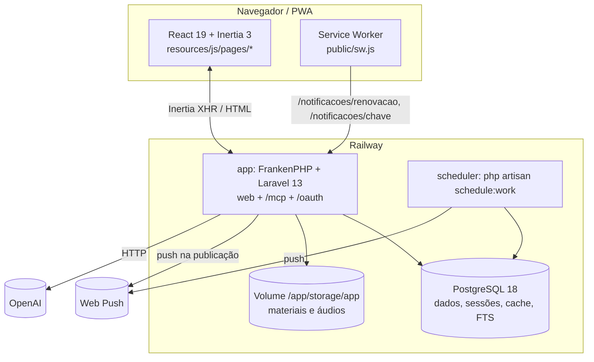
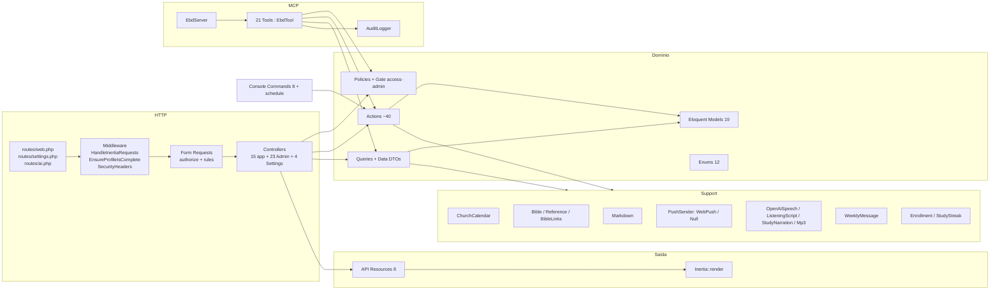
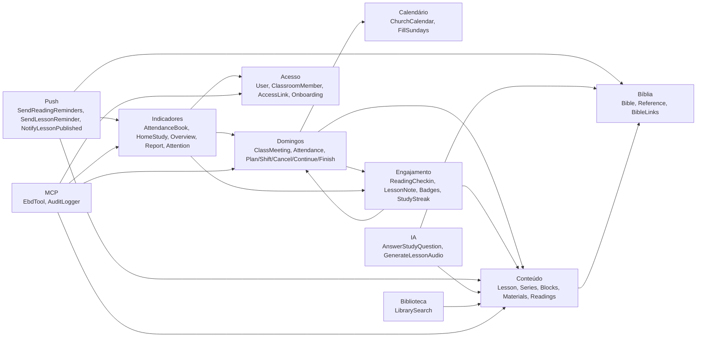

# 01 — Arquitetura como está (as-is)

Auditoria EBD 360 · engenharia reversa do código em `engineering/ebd-360` (2026-10-19). Toda afirmação traz `caminho:linha`. O que não foi conferido no código está marcado **NÃO VERIFICADO**. Nenhum teste foi executado nesta auditoria (o banco de testes estava em uso por outro processo): "coberto por teste" quer dizer que existe um teste que exercita o caminho, não que ele passa.

---

## 1. C4 simplificado

### 1.1 Contexto

```mermaid
flowchart LR
    aluno([Aluno<br/>link pessoal ou e-mail/senha])
    visitante([Visitante<br/>sem login])
    prof([Professor<br/>de uma ou mais classes])
    admin([Administrador<br/>is_admin])
    agente([Agente de IA<br/>Claude via MCP])
    ebd[[Sistema EBD<br/>monólito Laravel + Inertia/React]]
    wa[(WhatsApp<br/>canal de aviso, manual)]
    push[(Serviços Web Push<br/>Google/Apple/Mozilla)]
    openai[(OpenAI<br/>TTS + Responses)]
    smtp[(SMTP<br/>hoje MAIL_MAILER=log)]

    visitante -->|lições públicas, biblioteca, Bíblia| ebd
    aluno -->|estudo da semana, leituras, anotações, dúvidas| ebd
    prof -->|gestão: classes, domingos, chamada, lições| ebd
    admin -->|tudo + classes e professores| ebd
    agente -->|OAuth + /mcp, age como o professor| ebd
    prof -.->|copia e cola mensagem / link pessoal| wa
    ebd -->|VAPID| push
    ebd -->|áudio do estudo, tirar dúvida| openai
    ebd -.->|reset de senha (fila)| smtp
```

Evidências: rotas públicas `routes/web.php:30-36,97-99`; estudo autenticado `routes/web.php:41-58`; gestão `routes/web.php:107-196`; MCP `routes/ai.php:16-19`; push `app/Support/Push/WebPushSender.php:25-44`; OpenAI `app/Support/Audio/OpenAiSpeech.php:17-19,89`; WhatsApp só como texto pronto (`app/Support/WeeklyMessage.php:18-60`, `app/Http/Controllers/Admin/StudentAccessController.php:84-92`); e-mail em `log` em produção (`README.md:355`, valor de ambiente, NÃO VERIFICADO no Railway).

### 1.2 Contêineres



- Um único processo web; a fila é `sync` em produção e não há worker (`README.md:318`). O que é "assíncrono" é feito depois da resposta no próprio processo (`app/Actions/Lessons/RequestLessonAudio.php:64-69`).
- O agendamento é um contêiner separado com o mesmo código (`routes/console.php:20-47`; `README.md:318`).
- Desenvolvimento usa outro arranjo (`compose.yaml` com `worker`, Redis, Mailpit; `README.md:95-102`). Dev e produção divergem em fila, cache e servidor HTTP.

### 1.3 Componentes (backend)



Contagens: `find app -type f` → 225 arquivos; 16 749 linhas PHP em `app/` + `config/ebd.php` (medido nesta auditoria).

---

## 2. Camadas e padrões reais

| Camada                     | Regra declarada (`docs/arquitetura.md:9-23`) | O que o código faz                                                                                                 | Evidência                                                                                                                                                                                                                                                                |
| -------------------------- | -------------------------------------------- | ------------------------------------------------------------------------------------------------------------------ | ------------------------------------------------------------------------------------------------------------------------------------------------------------------------------------------------------------------------------------------------------------------------ |
| Form Request               | valida                                       | valida **e autoriza** (`authorize()`), inclusive resolvendo a classe a partir do payload                           | `app/Http/Requests/Admin/LessonRequest.php:16-27,86-95`; `app/Http/Requests/Admin/ClassroomMemberRequest.php:12-22`                                                                                                                                                      |
| Controller                 | fino                                         | Maioria fina; vários fazem consulta e montagem de arrays de props extensos (sem Resource)                          | `app/Http/Controllers/Admin/StudentController.php:55-91,113-170`; `app/Http/Controllers/Admin/ClassroomReportController.php:45-86,121-198`; `app/Http/Controllers/Admin/ClassMeetingController.php:156-227`; `app/Http/Controllers/Admin/DashboardController.php:43-101` |
| Action                     | uma classe, `handle()`                       | Confirmado. Algumas Actions abortam HTTP (`abort(403)`) e outras lançam `ValidationException` como erro de domínio | `app/Actions/Engagement/RecordReadingCheckin.php:31-33`; `app/Actions/Meetings/RecordAttendance.php:32-53`                                                                                                                                                               |
| CRUD trivial no controller | sim                                          | Leituras e notas                                                                                                   | `app/Http/Controllers/Admin/LessonReadingController.php:16,25,36`; `app/Http/Controllers/Admin/MeetingNoteController.php:23`                                                                                                                                             |
| Query                      | leitura com regra                            | Confirmado, com DTOs `final readonly` em `app/Queries/Data`                                                        | `app/Queries/Data/CurrentLesson.php:12-30`; `app/Queries/Data/AttendanceBook.php:14-28`; `app/Queries/Data/Period.php:13-20`                                                                                                                                             |
| Resource                   | formato das props                            | Usado em ~metade das telas; o resto são arrays ad hoc                                                              | ad hoc: `app/Queries/ClassroomOverviewQuery.php:61-125`, `app/Http/Controllers/Admin/ClassroomQuestionController.php:42-69`                                                                                                                                              |
| Policy                     | autorização                                  | 5 policies + Gate `access-admin`; regra central em `User::canManageClassroom`                                      | `app/Providers/AppServiceProvider.php:107-110`; `app/Models/User.php:183-194`                                                                                                                                                                                            |
| Sem repository/DTO         | —                                            | Confirmado; escopos Eloquent (`visibleTo`, `active`, `fromDate`, `chronological`)                                  | `app/Models/Lesson.php:238-266`; `app/Models/ClassMeeting.php:103-125`                                                                                                                                                                                                   |

Padrões transversais:

- **Validação compartilhada por traits** entre telas, MCP e CLI: `app/Concerns/LessonValidationRules.php:25-86`, `app/Concerns/MeetingValidationRules.php:19-80`, `app/Concerns/StudentValidationRules.php` (usado em `app/Http/Controllers/Admin/StudentAccessController.php:24-34`).
- **Cache de papéis por instância** de `User` (uma consulta por request por usuário): `app/Models/User.php:43-48,269-276`; invalidação manual com `flushClassroomRoles()` (`app/Models/User.php:281-286`, usada em `app/Actions/Classrooms/CreateManagedStudent.php:46`, `app/Actions/Classrooms/MoveStudentToClassroom.php:38`, `app/Http/Controllers/Admin/ClassroomMemberController.php:50,101`).
- **Datas no fuso da igreja comparadas como texto `Y-m-d`**: `app/Support/ChurchCalendar.php:28-35,54`.
- **Integridade no banco**: `CHECK` para enums e regras (`database/migrations/2026_09_23_000700_create_lesson_blocks_table.php:29-32`, `database/migrations/2026_09_23_000400_create_lesson_content_tables.php:34-35`), índices únicos parciais (`database/migrations/2026_09_23_001100_create_access_links_table.php:39`, `database/migrations/2026_09_23_000600_add_revista_fields_to_lessons.php:25`).
- **Prevenção de N+1 fora de produção**: `app/Providers/AppServiceProvider.php:75-76`.
- **Recursos sem envelope `data`**: `app/Providers/AppServiceProvider.php:80`.

---

## 3. Fluxo Inertia e tipagem PHP ↔ TS

```mermaid
sequenceDiagram
    participant B as Navegador (React)
    participant MW as HandleInertiaRequests
    participant C as Controller
    participant Q as Query/Action
    participant R as Resource / array
    B->>MW: GET /licoes/{slug} (X-Inertia)
    MW->>MW: share(): auth.user, church, features, push.public_key
    MW->>C: LessonController::show
    C->>C: authorizeView (redirect login p/ visitante em restrita; 404 p/ logado)
    C->>Q: present(): load filtrado por audience
    Q-->>R: LessonResource->withContent()->withTeacherContent($teacher)
    R-->>B: page "lessons/show" + props
    B->>C: POST /licoes/{slug}/leituras (form Inertia)
    C-->>B: back() + Inertia::flash('toast'|'badges')
```

- Props compartilhadas: `app/Http/Middleware/HandleInertiaRequests.php:39-71`. Tipadas no front por augment de módulo: `resources/js/types/global.d.ts:9-19`.
- Flash: `app/Http/Controllers/Controller.php:15-21` (toast), `app/Http/Controllers/Concerns/CelebratesBadges.php:15-25` (selos), `app/Http/Controllers/Admin/StudentAccessController.php:84-92` (link em claro). Consumo no front por evento `flash` e `as` cast: `resources/js/hooks/use-flash-toast.ts:8-16`, `resources/js/components/admin/students/access-card.tsx:78-80`.
- Erros 403/404/500/503 viram a página Inertia `error`; 419 volta com toast: `bootstrap/app.php:52-76`.
- **Wayfinder** gera funções de rota tipadas (`vite.config.ts` com `wayfinder({ formVariants: true })`; `README.md:147`). Uso real: 106 imports de `@/routes` e 3 de `@/actions` nas páginas/componentes (contagem nesta auditoria); até os `fetch()` manuais usam Wayfinder (`resources/js/components/lesson/study-helper.tsx:71`, `resources/js/components/lesson/rich-text.tsx:81`). Exceção: o service worker usa URLs literais (`public/sw.js:145,166`).
- **Tipos de dados não são gerados**: `resources/js/types/ebd.ts` (264 linhas) espelha os Resources à mão; páginas declaram tipos locais e até exportam tipos para outras páginas (`resources/js/pages/admin/classrooms/students/show.tsx:35-36` importa de `@/pages/my-progress`). Renomear uma rota quebra o `tsc`; renomear um campo de Resource ou de array ad hoc **não** quebra nada em tempo de compilação.

---

## 4. Mapa de módulos/domínios e dependências



Arestas que importam (com evidência):

| De → Para                                                                      | Evidência                                                                                                                                                                      |
| ------------------------------------------------------------------------------ | ------------------------------------------------------------------------------------------------------------------------------------------------------------------------------ |
| Domingos → Engajamento (chamada concede selos)                                 | `app/Actions/Meetings/RecordAttendance.php:77-85`                                                                                                                              |
| Engajamento → Domingos (selos leem encontros/presenças)                        | `app/Actions/Engagement/AwardBadges.php:144-243`                                                                                                                               |
| Push → Query de leitura da tela (`CurrentLessonQuery`)                         | `app/Actions/Notifications/SendReadingReminders.php:30-33,53`                                                                                                                  |
| Push "publicação" ← Action de lição (via evento)                               | `app/Actions/Lessons/ChangeLessonStatus.php:44-50` → `app/Listeners/NotifyClassroomOfLessonPublished.php:18-26` → `app/Actions/Notifications/NotifyLessonPublished.php:20-39`  |
| `NotifyLessonPublished`/`SendLessonReminder` → método estático de outra Action | `app/Actions/Notifications/NotifyLessonPublished.php:23`, `app/Actions/Notifications/SendLessonReminder.php:40` → `app/Actions/Notifications/SendReadingReminders.php:110-115` |
| IA "dúvida" → cliente de **voz**                                               | `app/Actions/Lessons/AnswerStudyQuestion.php:52-57` usa `OpenAiSpeech::write` (`app/Support/Audio/OpenAiSpeech.php:54`)                                                        |
| Controller público → Controller (método estático)                              | `app/Http/Controllers/LessonController.php:141` chama `StudyQuestionController::canAsk` (`app/Http/Controllers/StudyQuestionController.php:37-41`)                             |
| Resumo da classe compartilhado com MCP                                         | `app/Queries/ClassroomOverviewQuery.php:18-21`; `app/Mcp/Tools/GetClassroomOverview.php:36`                                                                                    |
| Calendário → todas as regras de "hoje"                                         | `app/Support/ChurchCalendar.php:23-35,62-80`                                                                                                                                   |

---

## 5. Eventos, notificações e agendamentos

### 5.1 Mapa de eventos

```mermaid
flowchart LR
    pub[POST /admin/licoes/{id}/status<br/>LessonStatusController] --> cls[ChangeLessonStatus]
    cls -->|draft→published, 1ª vez ou após despublicar| ev((LessonPublished))
    ev --> lis[NotifyClassroomOfLessonPublished<br/>try/catch, retorna int ou null]
    lis --> nlp[NotifyLessonPublished] --> ps[PushSender]
    cron1[[09:00 diário]] --> rr1[ebd:remind-readings morning] --> srr[SendReadingReminders] --> ps
    cron2[[20:00 diário]] --> rr2[ebd:remind-readings evening] --> srr
    cron3[[sáb 08:00]] --> rl[ebd:remind-lesson] --> slr[SendLessonReminder] --> ps
    cron4[[03:30]] --> prune[model:prune AuditLog]
    cron5[[03:40]] --> pp[passport:purge]
    cron6[[03:50]] --> fs[FillSundays por classe ativa]
    get[GET /admin/classes/{c}/domingos] --> fs
    reset[Fortify reset password] --> rpn[ResetPasswordNotification<br/>ShouldQueue] --> mail[(mail)]
    term[app()->terminating] --> gla[GenerateLessonAudio]
```

| Gatilho             | Onde                                                               | Efeito                                                           | Evidência                                                                                                                                               |
| ------------------- | ------------------------------------------------------------------ | ---------------------------------------------------------------- | ------------------------------------------------------------------------------------------------------------------------------------------------------- |
| `LessonPublished`   | `ChangeLessonStatus` só quando `$wasDraft`                         | push para todos os membros com aparelho, incluindo quem publicou | `app/Actions/Lessons/ChangeLessonStatus.php:30,44-50`; `app/Actions/Notifications/NotifyLessonPublished.php:10-11,23`                                   |
| Listener            | descoberta automática de eventos (não há `Event::listen` para ele) | falha não bloqueia a publicação                                  | `app/Providers/AppServiceProvider.php:102` (único listen); `app/Listeners/NotifyClassroomOfLessonPublished.php:20-26`                                   |
| Agendamentos        | `routes/console.php` no fuso da igreja, `onOneServer`              | lembretes 09h/20h/sáb 08h; limpezas; `FillSundays`               | `routes/console.php:26-36,39-40,43-47`                                                                                                                  |
| Pós-resposta        | `RequestLessonAudio`                                               | gera MP3 no mesmo processo, sem fila                             | `app/Actions/Lessons/RequestLessonAudio.php:60-69`; `app/Actions/Lessons/GenerateLessonAudio.php:32-33`                                                 |
| Notificação Laravel | reset de senha                                                     | enfileirada (fila `sync` em produção ⇒ síncrona)                 | `app/Notifications/ResetPasswordNotification.php:14`; `README.md:318`                                                                                   |
| Selos               | síncronos na ação (check-in e chamada)                             | `user_badges` com `insertOrIgnore`                               | `app/Actions/Engagement/RecordReadingCheckin.php:48`; `app/Actions/Meetings/RecordAttendance.php:80-85`; `app/Actions/Engagement/AwardBadges.php:65-75` |

Re-publicar depois de despublicar dispara de novo o aviso para a classe inteira (a condição é só "estava em rascunho") e grava um `published_at` novo, porque despublicar zera o campo: `app/Actions/Lessons/ChangeLessonStatus.php:30,34-37,44`.

---

## 6. Acoplamento e complexidade acidental

1. **Escrita em GET.** Abrir a lista de domingos insere encontros (`FillSundays`) a cada visita: `app/Http/Controllers/Admin/ClassMeetingController.php:46`. Também roda no cron (`routes/console.php:43-47`). `FillSundays` preenche desde o **primeiro** encontro da classe, então cria domingos passados que viram "pendências" (`app/Actions/Meetings/FillSundays.php:32-35`; pendência = planejado no passado, `app/Queries/ClassroomOverviewQuery.php:98-111`).
2. **Geração de áudio no processo web.** `set_time_limit(0)` + `ignore_user_abort` + `app()->terminating` (`app/Actions/Lessons/GenerateLessonAudio.php:32-33`; `app/Actions/Lessons/RequestLessonAudio.php:64-69`). Se o contêiner reiniciar, o estado fica "generating" até o timeout de 15 min (`app/Models/Lesson.php:73,222-226`). Com uma réplica (`README.md:336`), uma geração longa ocupa um worker do FrankenPHP.
3. **Cliente OpenAI com nome de voz usado para texto.** `OpenAiSpeech` atende TTS e Responses (`app/Support/Audio/OpenAiSpeech.php:17-19,29,54`); o "Tirar dúvida" depende dele (`app/Actions/Lessons/AnswerStudyQuestion.php:52,56`). A disponibilidade do helper é decidida por `app(OpenAiSpeech::class)` estático (`app/Actions/Lessons/AnswerStudyQuestion.php:54-57`).
4. **Regra de "o que é a lição da semana" replicada em vários lugares** com variações: `CurrentLessonQuery` (`app/Queries/CurrentLessonQuery.php:25-77`), `ClassroomOverviewQuery::week` que avança após "Encerrar aula" (`app/Queries/ClassroomOverviewQuery.php:230-243`), `MeetingForLessonQuery` para o Modo Domingo (`app/Queries/MeetingForLessonQuery.php:15-22`), `Lesson::readingWeekdayToday` (`app/Models/Lesson.php:176-185`). Quatro definições de "encontro atual".
5. **Leitura da semana depende de um usuário arbitrário.** O lembrete usa `$recipients->first()` para decidir a lição (`app/Actions/Notifications/SendReadingReminders.php:53`); como a visibilidade passa pela policy (`app/Queries/CurrentLessonQuery.php:57`), o resultado depende de quem é o primeiro (professor vê rascunho). Contornado pela checagem de status na linha 56.
6. **Duas fontes de verdade para data da lição.** `lessons.scheduled_for` é cache mantido por `SyncLessonSchedule` (`app/Actions/Lessons/SyncLessonSchedule.php:19-25`), chamado manualmente em cada Action de agenda (`app/Actions/Meetings/CancelMeeting.php:47`, `ContinueLessonNextMeeting.php:65`, `PlanMeetings.php:57`, `SaveMeeting.php:48`, `app/Actions/Lessons/CreateLesson.php:76`, `app/Http/Controllers/Admin/MeetingStatusController.php:81`). `MeetingStatusController::held` não sincroniza (não muda data, ok) e `FillSundays` não sincroniza (não atribui lição, ok); qualquer novo caminho que mude `lesson_id` precisa lembrar disso.
7. **Arrays de props ad hoc** em vez de Resources (ver §2), sem tipo gerado no front (§3).
8. **Autorização espalhada em três estilos**: `Gate::authorize` no controller, `authorize()` no Form Request e `abort_unless` com checagem manual (`app/Http/Controllers/LessonNoteController.php:23`, `app/Http/Controllers/StudyQuestionController.php:23`, `app/Http/Controllers/Admin/StudentAccessController.php:71-72`), além de `abort(404)` **dentro da policy** (`app/Policies/ClassroomPolicy.php:61-63`).
9. **Divergência web × MCP na mesma operação.** Editar aluno: web exige `viewStudentProgress` (`app/Http/Controllers/Admin/StudentController.php:175`), MCP exige só `manageMembers` (`app/Mcp/Tools/UpdateStudent.php:42`); a Action barra staff nos dois (`app/Actions/Classrooms/UpdateStudentProfile.php:23-25`).
10. **Bible::passage por item** em Resources (`app/Http/Resources/LessonReadingResource.php:45`, `app/Http/Resources/LessonResource.php:68,85`): uma consulta por referência; decisão documentada (`docs/arquitetura.md:62`).
11. **Middleware `verified` sem efeito**: `routes/settings.php:25`; `User` não implementa `MustVerifyEmail` (`app/Models/User.php:37`).
12. **Teste morto de 2FA** (feature removida) mantido com skip: `tests/Feature/Auth/AuthenticationTest.php:35-36`.

---

## 7. Divergências docs × código

| Documento                                               | Diz                                                                      | Código                                                                                                                | Evidência                                                                                                       |
| ------------------------------------------------------- | ------------------------------------------------------------------------ | --------------------------------------------------------------------------------------------------------------------- | --------------------------------------------------------------------------------------------------------------- |
| `docs/arquitetura.md:152`, `README.md:14`               | Abas da classe: Resumo · Domingos · Alunos · Relatório                   | Há também **Dúvidas**                                                                                                 | `resources/js/components/admin/classroom-header.tsx:46`; `routes/web.php:162`                                   |
| `docs/arquitetura.md:58`                                | "JSON/JSONB não foi usado"                                               | `audit_logs.arguments/changes` são `jsonb`                                                                            | `database/migrations/2026_09_25_000600_create_audit_logs_table.php:21,24`                                       |
| `docs/arquitetura.md:230`                               | Sem Dockerfile de produção nem pipeline                                  | Existe `Dockerfile` raiz + `railway.json`, deploy por push na main                                                    | `Dockerfile:58`; `README.md:302,331-332,416`                                                                    |
| `docs/arquitetura.md` e `README.md`                     | Nenhuma menção a áudio do estudo por OpenAI nem "Tirar dúvida" com IA    | Funcionalidades completas, com config e chave `OPENAI_API_KEY`                                                        | `config/ebd.php:98-125`; `routes/web.php:50-52,75-77,177`; `.env.example:107`                                   |
| `docs/arquitetura.md:232`                               | `Content-Range` não suportado no stream local                            | Áudio do estudo usa `response()->file()` (BinaryFileResponse, aceita Range); materiais continuam por `disk->response` | `app/Http/Controllers/LessonAudioController.php:12-13,39`; `app/Http/Controllers/MaterialFileController.php:60` |
| `README.md:200`; `app/Events/LessonPublished.php:10-11` | `LessonPublished` é "gancho para notificações futuras (… push …)"        | Já dispara push                                                                                                       | `app/Listeners/NotifyClassroomOfLessonPublished.php:18-26`                                                      |
| `README.md:199`                                         | Enums: 5 listados                                                        | 12 enums (Badge, BibleBook, ContentAudience, Gender, LessonBlockKind, MeetingStatus, ReminderSlot…)                   | `app/Enums/`                                                                                                    |
| `README.md:210-211`                                     | Queries = "próxima aula, biblioteca"; Support = ChurchCalendar, Markdown | 9 Queries + 3 DTOs; Support com Bible, Push, Audio, Audit, Enrollment, StudyStreak, WeeklyMessage, SplashVerse        | `app/Queries/`, `app/Support/`                                                                                  |
| `app/Console/Commands/RemindReadings.php:11`            | evening = "só para quem ainda não leu"                                   | À noite todos recebem, com texto diferente para quem já leu                                                           | `app/Actions/Notifications/SendReadingReminders.php:75-87`; `README.md:254` (o README está certo)               |
| `app/Http/Controllers/Admin/LessonController.php:196`   | "a lição excluída pode ser restaurada"                                   | Não há rota nem ação de restaurar                                                                                     | `routes/web.php:171-174` (resource sem restore); grep `restore` só em encontros e membros                       |
| `config/ebd.php:50-51`                                  | "painel de evolução da classe"                                           | A tela "evolução" virou redirect para o Resumo                                                                        | `routes/web.php:140`                                                                                            |
| `docs/arquitetura.md:20`                                | Lista de Queries                                                         | Omite `StudentProgressQuery`, `StudentsNeedingAttention`, `MeetingForLessonQuery` (esta citada em outro trecho)       | `app/Queries/`                                                                                                  |
| `docs/arquitetura.md:187`                               | Rate limits: login, link, estudo, arquivos, biblioteca                   | Também `study-helper` 5/min, `mcp` 120/min, OAuth 30/min, avatar 10/min, senha 6/min                                  | `app/Providers/AppServiceProvider.php:124,129`; `routes/ai.php:16`; `routes/settings.php:17,32`                 |

Pontos em que a documentação confere com o código (amostra): matriz público/privado (`docs/arquitetura.md:92-99` ↔ `app/Policies/LessonPolicy.php:20-44`, `app/Http/Controllers/LessonController.php:61-73`); token no fragmento (`docs/arquitetura.md:178` ↔ `app/Http/Controllers/AccessLinkController.php:22-37`); MCP nunca publica (`docs/arquitetura.md:196` ↔ `tests/Feature/Mcp/McpLessonToolsTest.php:189`).
