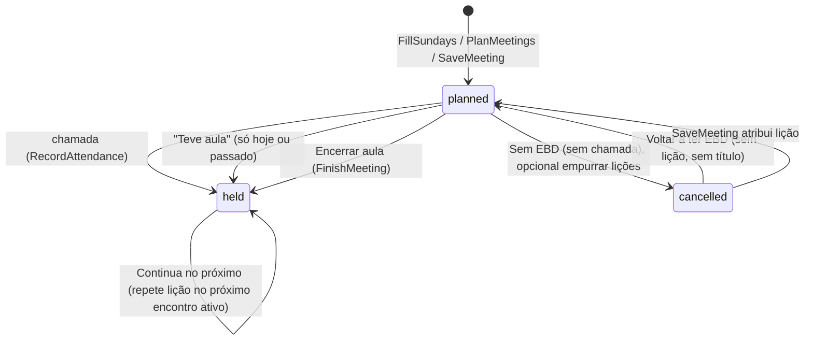

# 02 — Modelo de domínio

Auditoria EBD 360 · fonte: `database/migrations/*`, `app/Models/*`, `app/Enums/*`, `app/Actions/*`, `app/Policies/*`. Tabelas de infraestrutura (sessions, cache, jobs, oauth_*) só aparecem quando importam para o domínio.

---

## 1. Diagrama ER

```mermaid
erDiagram
    users ||--o{ classroom_user : "papel por classe"
    classrooms ||--o{ classroom_user : ""
    classrooms ||--o{ series : "restrict"
    classrooms ||--o{ lessons : "restrict"
    series |o--o{ lessons : "restrict, opcional"
    lessons ||--o{ lesson_blocks : cascade
    lessons ||--o{ lesson_materials : cascade
    lessons ||--o{ lesson_readings : cascade
    lessons }o--o{ users : "lesson_authors"
    classrooms ||--o{ class_meetings : cascade
    lessons |o--o{ class_meetings : "restrict, opcional"
    class_meetings ||--o{ attendances : cascade
    users ||--o{ attendances : "aluno (cascade) / recorded_by (null)"
    users ||--o{ access_links : cascade
    classrooms |o--o{ access_links : "null on delete"
    users ||--o{ reading_checkins : cascade
    lessons ||--o{ reading_checkins : cascade
    lesson_readings |o--o{ reading_checkins : "null on delete"
    users ||--o{ lesson_notes : cascade
    lessons ||--o{ lesson_notes : cascade
    users ||--o{ user_badges : cascade
    series |o--o{ user_badges : "cascade, só selos por série"
    users ||--o{ push_subscriptions : cascade
    classrooms ||--o{ student_notes : cascade
    users ||--o{ student_notes : "aluno cascade / autor null"
    users ||--o{ study_questions : cascade
    lessons ||--o{ study_questions : cascade
    users |o--o{ audit_logs : "null on delete"
    classrooms |o--o{ audit_logs : "null on delete"

    users {
        bigint id PK
        string name
        string email "nullable, unique"
        string password "nullable = conta gerenciada"
        string phone "só dígitos com DDI"
        date birth_date
        string gender "CHECK male|female"
        bool is_admin
        string avatar_path
    }
    classroom_user {
        bigint id PK
        bigint classroom_id FK
        bigint user_id FK
        string role "CHECK teacher|student"
        timestamp created_at "= entrada na classe"
    }
    classrooms {
        bigint id PK
        string slug UK
        bool is_active
        smallint position
    }
    series {
        bigint id PK
        bigint classroom_id FK
        string slug "UK por classe"
        date starts_on
        date ends_on
    }
    lessons {
        bigint id PK
        bigint classroom_id FK
        bigint series_id FK
        smallint number "UK parcial (series_id, number)"
        string slug "UK global, inclui excluídas"
        string status "CHECK draft|published"
        string visibility "CHECK public|members"
        date scheduled_for "cache do 1º encontro"
        text content "Markdown"
        text blocks_text "texto de busca"
        tsvector search_vector "GENERATED"
        string audio_path
        char audio_source_hash
        string audio_status
        timestamp deleted_at "soft delete"
    }
    lesson_blocks {
        string kind "CHECK 9 tipos"
        string audience "CHECK teacher|student"
        smallint drip_weekday "1-7, só aluno"
        int position
    }
    lesson_materials {
        string type "CHECK pdf|file|link|video|audio|reference"
        string audience
        string url
        string disk
        string path
        bool is_primary
    }
    lesson_readings {
        smallint weekday "1-7 ou null"
        string reference
    }
    class_meetings {
        bigint id PK
        bigint classroom_id FK
        bigint lesson_id FK
        date held_on "UK (classroom_id, held_on)"
        string status "CHECK planned|held|cancelled"
        string title "evento ou motivo sem EBD"
        text notes "onde paramos (professor)"
        timestamp attendance_taken_at
        timestamp finished_at
        smallint visitors_count
    }
    attendances {
        bigint class_meeting_id FK
        bigint user_id FK "UK (meeting, user)"
        bigint recorded_by FK
    }
    access_links {
        char token_hash "sha256, UK"
        timestamp revoked_at "UK parcial: 1 ativo por user"
        timestamp expires_at
        int use_count
        bigint created_by FK
    }
    reading_checkins {
        smallint weekday "UK (user, lesson, weekday)"
        date read_on "quando marcou"
    }
    user_badges {
        string badge "CHECK 5 selos"
        timestamp awarded_at "UK (user, badge, coalesce(series,0))"
    }
    push_subscriptions {
        string endpoint UK
        string public_key
        string auth_token
    }
    study_questions {
        text question
        text answer
    }
    audit_logs {
        string source "mcp"
        string client_id
        string tool
        jsonb arguments
        jsonb changes
        string status "ok|denied|failed"
    }
    bible_verses {
        smallint book "CHECK 1-66"
        smallint chapter
        smallint verse "UK (book, chapter, verse)"
        text text
    }
```

Evidências por tabela: `users` `database/migrations/0001_01_01_000000_create_users_table.php:14-23` + `2026_09_23_001100_create_access_links_table.php:14-18` + `2026_09_23_001700_add_avatar_path_to_users.php:13` + `2026_09_28_000100_add_profile_fields_to_users_table.php:14-18`; `classrooms`/`classroom_user` `2026_09_23_000100_create_classrooms_table.php:12-35`; `series` `2026_09_23_000200_create_series_table.php:11-22`; `lessons` `2026_09_23_000300_create_lessons_table.php:27-74`, `2026_09_23_000600_add_revista_fields_to_lessons.php:15-58`, `2026_09_23_001000_backfill_meetings_and_simplify_lesson_status.php:44-59`, `2026_09_23_001600_drop_magazine_author_and_bible_text_from_lessons.php:13`, `2026_10_05_000100_add_audio_to_lessons_table.php:14-23`; conteúdo `2026_09_23_000400_create_lesson_content_tables.php:14-61`, `2026_09_23_000700_create_lesson_blocks_table.php:14-32`, `2026_09_23_000900_add_audience_to_lesson_materials.php:14-17`; `class_meetings` `2026_09_23_000500_create_class_meetings_table.php:14-33` + `2026_10_04_000100_add_finished_at_to_class_meetings_table.php:14`; `access_links` `2026_09_23_001100_create_access_links_table.php:23-39`; engajamento `2026_09_23_001200_create_engagement_tables.php:13-64` + `2026_09_23_001500_add_weekday_to_reading_checkins.php:15-43` + `2026_09_23_001400_remove_questions_and_review.php:13-18`; `attendances` `2026_09_23_001300_create_attendances_table.php:13-21`; `bible_verses` `2026_09_24_000100_create_bible_verses_table.php:15-25`; `push_subscriptions` `2026_09_24_000300_create_push_subscriptions_table.php:14-22`; `audit_logs` `2026_09_25_000600_create_audit_logs_table.php:14-30`; `student_notes` `2026_09_28_000200_create_student_notes_table.php:13-21`; `study_questions` `2026_10_09_000100_create_study_questions_table.php:13-22`.

Observações de modelagem:

- `lessons.search_vector` é coluna gerada com pesos A (título, texto bíblico), B (resumo, versículo-chave, alvo), C (estudo), D (`blocks_text`): `database/migrations/2026_09_23_000600_add_revista_fields_to_lessons.php:26-33`. `blocks_text` só recebe blocos de aluno: `app/Actions/Lessons/SyncLessonSearchText.php:16-24`.
- `reading_checkins.lesson_reading_id` existe mas a unicidade é por `(user, lesson, weekday)` (`database/migrations/2026_09_23_001500_add_weekday_to_reading_checkins.php:40`): o check-in é do **dia do plano**, não da leitura.
- `user_badges` usa índice com expressão `COALESCE(series_id,0)` para unicidade de selos globais e por série: `database/migrations/2026_09_23_001200_create_engagement_tables.php:64`.
- Soft delete só em `Lesson` (`app/Models/Lesson.php:76`). `class_meetings.lesson_id` é `restrictOnDelete` (`database/migrations/2026_09_23_000500_create_class_meetings_table.php:18`), então um hard delete de lição com encontros falharia; o app só faz soft delete (`app/Http/Controllers/Admin/LessonController.php:194-199`).
- `lesson_authors` (pivot sem model) é preenchido na criação/edição (`app/Actions/Lessons/CreateLesson.php:35,47`; `app/Actions/Lessons/UpdateLesson.php:37-39`) e só exibido (`app/Http/Resources/LessonResource.php:76`); não participa de nenhuma regra de permissão.
- Tabelas `lesson_questions` e `question_attempts` foram criadas e depois removidas (`database/migrations/2026_09_23_001400_remove_questions_and_review.php:13-14`).

---

## 2. Enums

| Enum               | Valores                                                                                              | Regras embutidas                                                                            | Evidência                             |
| ------------------ | ---------------------------------------------------------------------------------------------------- | ------------------------------------------------------------------------------------------- | ------------------------------------- |
| `ClassroomRole`    | teacher, student                                                                                     | —                                                                                           | `app/Enums/ClassroomRole.php:5-8`     |
| `LessonStatus`     | draft, published                                                                                     | transições draft↔published; só published é visível                                          | `app/Enums/LessonStatus.php:15-58`    |
| `LessonVisibility` | public, members                                                                                      | —                                                                                           | `app/Enums/LessonVisibility.php:5-11` |
| `MeetingStatus`    | planned, held, cancelled ("Sem EBD")                                                                 | —                                                                                           | `app/Enums/MeetingStatus.php:8-21`    |
| `ContentAudience`  | teacher, student                                                                                     | conteúdo teacher nunca vai a aluno/visitante nem à busca                                    | `app/Enums/ContentAudience.php:5-12`  |
| `LessonBlockKind`  | roteiro, extra_time, accuracy_note, teacher_note, context, theology, curiosity, application, concept | 4 primeiros → audiência padrão teacher; drippable: curiosity, concept, context, application | `app/Enums/LessonBlockKind.php:9-50`  |
| `MaterialType`     | pdf, file, link, video, audio, reference                                                             | upload/URL obrigatórios por tipo                                                            | `app/Enums/MaterialType.php:7-33`     |
| `Weekday`          | 1..7 (ISO)                                                                                           | —                                                                                           | `app/Enums/Weekday.php:8-16`          |
| `Badge`            | first_full_week, streak_7, streak_30, faithful_reader, perfect_attendance                            | por série: faithful_reader, perfect_attendance                                              | `app/Enums/Badge.php:8-53`            |
| `Gender`           | male, female                                                                                         | —                                                                                           | `app/Enums/Gender.php:8-11`           |
| `ReminderSlot`     | morning, evening                                                                                     | —                                                                                           | `app/Enums/ReminderSlot.php:8-11`     |
| `BibleBook`        | 66 livros                                                                                            | parsing de abreviações (NÃO VERIFICADO em detalhe)                                          | `app/Enums/BibleBook.php`             |

Constantes de domínio fora de enum: `Lesson::AUDIO_GENERATING/AUDIO_FAILED`, `AUDIO_NARRATION_VERSION = 4`, `AUDIO_GENERATION_TIMEOUT_MINUTES = 15` (`app/Models/Lesson.php:64-73`); `AuditLog::STATUS_*` (`app/Models/AuditLog.php:51-55`); `FillSundays::WEEKS_AHEAD = 12` (`app/Actions/Meetings/FillSundays.php:21`); `StudentsNeedingAttention::NEW_STUDENT_DAYS = 14` (`app/Queries/StudentsNeedingAttention.php:16`).

---

## 3. Regras de negócio

### 3.1 Calendário dominical (fuso da igreja)

- "Hoje" é `now()->startOfDay()` no fuso `ebd.timezone` (padrão `America/Sao_Paulo`): `app/Support/ChurchCalendar.php:13-26`; `config/ebd.php:14`. Datas de banco comparadas como `Y-m-d` texto: `app/Support/ChurchCalendar.php:28-35`.
- Entrada do aluno na classe = `classroom_user.created_at` convertido para o fuso: `app/Support/ChurchCalendar.php:54`.
- **Todo domingo existe na agenda**: do primeiro encontro da classe (ou do domingo desta semana) até 12 semanas à frente, só inserindo o que falta (`insertOrIgnore` + UK): `app/Actions/Meetings/FillSundays.php:26-60`. Disparado diariamente às 03:50 (`routes/console.php:43-47`) e a cada GET de Domingos (`app/Http/Controllers/Admin/ClassMeetingController.php:46`).
- **Planejar trimestre**: cria um encontro por domingo no intervalo e distribui as lições da série sem encontro ativo, pela ordem de `number`, nos domingos planejados sem lição e sem título: `app/Actions/Meetings/PlanMeetings.php:29-93`. Limite do intervalo validado em `app/Concerns/MeetingValidationRules.php:39-46`.
- **Semana de leitura** de um encontro = segunda-feira daquela semana até o dia do encontro; fora dela não há "leitura de hoje": `app/Support/ChurchCalendar.php:62-80`.

### 3.2 Status de encontros

| Regra                                                                                                                                                                  | Evidência                                                                                                                |
| ---------------------------------------------------------------------------------------------------------------------------------------------------------------------- | ------------------------------------------------------------------------------------------------------------------------ |
| Chamada só no dia ou depois, nunca em "sem EBD"; marca `held` e grava `attendance_taken_at` na 1ª vez                                                                  | `app/Actions/Meetings/RecordAttendance.php:32-38,70-74`                                                                  |
| Chamada sincroniza só a lista dos alunos **atuais**; ausentes que saíram da classe ficam                                                                               | `app/Actions/Meetings/RecordAttendance.php:42-68`                                                                        |
| Rejeita ids fora do roster (exceto quem já estava presente)                                                                                                            | `app/Actions/Meetings/RecordAttendance.php:51-53`                                                                        |
| Cancelar exige não ter chamada; remove a lição do dia e, com `shift`, empurra as seguintes                                                                             | `app/Actions/Meetings/CancelMeeting.php:26-49`                                                                           |
| Empurrar: só encontros `planned` com lição ou sem título; um planejado vazio absorve; devolve a lição que sobrou                                                       | `app/Actions/Meetings/ShiftPlannedLessons.php:19-44`                                                                     |
| Continuar: exige lição e data ≤ hoje; marca `held`; se não há próximo encontro ativo cria um no próximo domingo livre                                                  | `app/Actions/Meetings/ContinueLessonNextMeeting.php:29-87`                                                               |
| Encerrar: não cancelado e data ≤ hoje; `held`, `notes`, `finished_at`; opcionalmente continua                                                                          | `app/Actions/Meetings/FinishMeeting.php:22-35`                                                                           |
| "Teve aula": só data ≤ hoje                                                                                                                                            | `app/Http/Controllers/Admin/MeetingStatusController.php:51-65`                                                           |
| Restaurar "sem EBD": volta a `planned`, `title = null`                                                                                                                 | `app/Http/Controllers/Admin/MeetingStatusController.php:72-86`                                                           |
| Um encontro por classe e dia                                                                                                                                           | `database/migrations/2026_09_23_000500_create_class_meetings_table.php:29`; `app/Concerns/MeetingValidationRules.php:24` |
| Lição do encontro precisa ser da mesma classe (e não excluída)                                                                                                         | `app/Actions/Meetings/SaveMeeting.php:28-34`; `app/Concerns/MeetingValidationRules.php:28`                               |
| **Lição da semana**: próximo encontro ativo (hoje incluído) com lição ou título; sem futuro, último `held` com lição (fallback); rascunho aparece como "em preparação" | `app/Queries/CurrentLessonQuery.php:25-77`                                                                               |
| No Resumo, após "Encerrar aula" de hoje o card passa ao próximo domingo                                                                                                | `app/Queries/ClassroomOverviewQuery.php:230-243`                                                                         |
| Modo Domingo conduz: encontro de hoje → último sem chamada → próximo                                                                                                   | `app/Queries/MeetingForLessonQuery.php:15-22`                                                                            |
| Pendência = encontro `planned` no passado (Resumo olha 8 semanas)                                                                                                      | `app/Queries/ClassroomOverviewQuery.php:26,98-111`; `app/Http/Controllers/Admin/DashboardController.php:57-64`           |

### 3.3 Presença e indicadores

- **Início na classe** (`Enrollment::sinceMap`): `LEAST(dia seguinte à entrada, primeira presença)`; só papel student: `app/Support/Enrollment.php:22-38`.
- Célula do livro: `null` antes do início, `true/false` depois: `app/Queries/Data/AttendanceBook.php:43-50`.
- Só entram domingos `held` com `attendance_taken_at` até hoje: `app/Queries/AttendanceBookQuery.php:42-50`.
- Frequência do aluno = presenças ÷ domingos com chamada desde o início; da classe = Σ presentes ÷ Σ esperados; visitantes fora da taxa: `app/Queries/Data/AttendanceBook.php:30-33,69-112,119-157`.
- Faltas seguidas: do domingo mais recente para trás até a primeira presença: `app/Queries/Data/AttendanceBook.php:125-137`.
- **Precisa de atenção**: ≥ `missed_meetings` (2) faltas seguidas, ou ≥ `inactive_days` (10) sem leitura nas lições da classe; ignora quem entrou há < 14 dias e quem completou o plano da lição atual: `app/Queries/StudentsNeedingAttention.php:23-66`; `config/ebd.php:53-56`.
- **Estudo em casa** por lição: leitores ÷ alunos que contavam no 1º domingo da lição; média de dias: `app/Queries/HomeStudyQuery.php:21-73`.
- Período padrão: série da lição da semana (se já começou; senão a anterior), senão últimos 3 meses: `app/Queries/Data/Period.php:59-89`. Relatório: `?serie=`, `?periodo=3m`, padrão semana → em andamento → última: `app/Http/Controllers/Admin/ClassroomReportController.php:96-113`.

### 3.4 Progresso semanal, leituras e selos

- Check-in: membro da classe que pode ver a lição; qualquer dia, qualquer momento, idempotente; `weekday` vem da leitura se informada; `read_on` = hoje no fuso: `app/Actions/Engagement/RecordReadingCheckin.php:29-48`. Desmarcar apaga só os próprios: `app/Http/Controllers/ReadingCheckinController.php:42-53`.
- Semana de estudo: dias seg→dom da semana do encontro, leituras por dia, blocos de aluno liberados por `drip_weekday` ou distribuição automática de curiosidade/conceito (um por dia, seg-sáb); progresso = dias marcados seg-sáb ÷ dias de leitura (excl. domingo), mínimo 1: `app/Queries/StudyWeekQuery.php:41-153`.
- Sequência: dias com leitura marcada ou presença; viva se o último foi hoje ou ontem: `app/Support/StudyStreak.php:19-80`.
- Selos (`AwardBadges`): semana completa = 6 dias (seg-sáb) numa lição; 7/30 dias de sequência máxima; leitor fiel = ≥ 3 dias em ≥ 80% das lições dadas da série (mín. 4 dadas); presença perfeita = presente em todos os domingos com chamada da série desde o início (mín. 4) e nenhum planejado futuro na série: `app/Actions/Engagement/AwardBadges.php:32-243`.
- Lembrete de leitura: só lição publicada, não fallback, dentro da semana de leitura; sem plano, de seg a sáb "releia o texto base"; à noite quem já marcou recebe outra mensagem: `app/Actions/Notifications/SendReadingReminders.php:38-144`.

### 3.5 Público × restrito

| Situação                            | Visitante              | Logado sem vínculo | Membro (aluno/prof. de outra) | Professor da classe / admin                                                             | Evidência                                                                                  |
| ----------------------------------- | ---------------------- | ------------------ | ----------------------------- | --------------------------------------------------------------------------------------- | ------------------------------------------------------------------------------------------ |
| Rascunho                            | 404                    | 404                | 404                           | vê                                                                                      | `app/Policies/LessonPolicy.php:22-28`; `app/Http/Controllers/LessonController.php:66-72`   |
| Publicada pública                   | vê                     | vê                 | vê                            | vê                                                                                      | `app/Policies/LessonPolicy.php:30-32`                                                      |
| Publicada só membros                | redirect login         | 404                | vê se membro **desta** classe | vê                                                                                      | `app/Policies/LessonPolicy.php:34`; `app/Http/Controllers/LessonController.php:66-68`      |
| Blocos/materiais de professor       | não carregados         | não                | não                           | vê                                                                                      | `app/Http/Controllers/LessonController.php:151-167`; `app/Policies/LessonPolicy.php:41-44` |
| Arquivo de material de professor    | 404                    | 404                | 404                           | baixa                                                                                   | `app/Http/Controllers/MaterialFileController.php:26-33`                                    |
| Listas (home, biblioteca, recentes) | só públicas publicadas | idem               | + restritas das suas classes  | admin: todas publicadas; professor: publicadas visíveis (rascunho não entra nas listas) | `app/Models/Lesson.php:251-266`                                                            |
| Áudio do estudo                     | mesma regra de `view`  |                    |                               |                                                                                         | `app/Http/Controllers/LessonAudioController.php:17-21`                                     |

Slug: global, colisão → `-{classe}` → numérico, reservando excluídas (`app/Actions/Lessons/GenerateLessonSlug.php:21-48`); editável só em rascunho (`app/Actions/Lessons/UpdateLesson.php:31-33`).

Ciclo editorial: criada sempre como rascunho (`app/Models/Lesson.php:81-84`; `app/Actions/Lessons/CreateLesson.php:15`); publicar grava `published_at` (se vazio) e dispara o aviso; despublicar zera `published_at`, então cada republicação gera data nova e novo aviso (`app/Actions/Lessons/ChangeLessonStatus.php:30-50`).

### 3.6 Links pessoais de acesso

| Regra                                                                                                                                | Evidência                                                                                                             |
| ------------------------------------------------------------------------------------------------------------------------------------ | --------------------------------------------------------------------------------------------------------------------- |
| Token 48 caracteres alfanuméricos no **fragmento** (`/entrar#token`); banco guarda só sha256                                         | `app/Actions/Access/IssueAccessLink.php:37,46,52`; `app/Models/AccessLink.php:46-49`                                  |
| Só para alunos da classe; nunca professor/admin (na emissão e no uso)                                                                | `app/Actions/Access/IssueAccessLink.php:29-35`; `app/Actions/Access/LoginWithAccessLink.php:28-30`                    |
| Um link ativo por pessoa (índice parcial); emitir revoga o anterior                                                                  | `database/migrations/2026_09_23_001100_create_access_links_table.php:39`; `app/Actions/Access/IssueAccessLink.php:41` |
| TTL opcional (`EBD_ACCESS_LINK_TTL_DAYS`), lembrar-me 400 dias                                                                       | `config/ebd.php:32-35`; `app/Actions/Access/LoginWithAccessLink.php:40-47`                                            |
| Entrar por link em conta com senha **apaga a senha** (recuperação)                                                                   | `app/Actions/Access/LoginWithAccessLink.php:36-38`                                                                    |
| GET não autentica; POST com formato validado; erro genérico; 10/min e 50/dia por IP                                                  | `app/Http/Controllers/AccessLinkController.php:22-37`; `app/Providers/AppServiceProvider.php:117-120`                 |
| Bloquear acesso: revoga, troca `remember_token`, apaga sessões (driver database)                                                     | `app/Actions/Access/RevokeStudentAccess.php:15-27`                                                                    |
| Remover da classe revoga o link daquela classe; conta gerenciada sem classe perde tudo                                               | `app/Http/Controllers/Admin/ClassroomMemberController.php:54-58`                                                      |
| Promover a professor revoga links                                                                                                    | `app/Actions/Classrooms/AddClassroomMember.php:39-42`                                                                 |
| Criar senha no "Completar cadastro" revoga o link                                                                                    | `app/Actions/Access/CompleteStudentProfile.php:39-41`                                                                 |
| Mudar de classe: link ativo passa a apontar para a nova                                                                              | `app/Actions/Classrooms/MoveStudentToClassroom.php:35`                                                                |
| Onboarding obrigatório para aluno (não staff) sem senha/e-mail/WhatsApp/nascimento/gênero; libera só onboarding, logout, link e push | `app/Models/User.php:216-232`; `app/Http/Middleware/EnsureProfileIsComplete.php:22-41`                                |

### 3.7 Papéis

- Papel é **por classe** (`classroom_user.role`), mais o global `users.is_admin`: `app/Models/User.php:158-194`.
- `canManageClassroom(c)` = admin ou professor de `c`: `app/Models/User.php:183-186`.
- `canAccessAdmin()` = admin ou professor de alguma classe; é o Gate `access-admin`: `app/Models/User.php:191-194`; `app/Providers/AppServiceProvider.php:109`.
- Conta "gerenciada" = sem senha: `app/Models/User.php:134-137`.
- Uma pessoa pode ser professora numa classe e aluna em outra (`tests/Feature/Admin/ClassroomMemberTest.php:95`); nesse caso é staff para link, onboarding e edição de dados (`app/Models/User.php:231`; `app/Actions/Classrooms/UpdateStudentProfile.php:23`).
- Admin não precisa ser membro; sem vínculo, não tem semana de estudo (`app/Http/Middleware/HandleInertiaRequests.php:62`).

---

## 4. Matriz de permissões

Legenda: ✅ permitido · ❌ negado · 🔒 redirect para login · 404 = negado sem revelar. "Prof." = professor **da classe em questão**; professor de outra classe se comporta como "Logado" para esta classe (exceto que acessa `/admin`). Guardas: **R** = rota/middleware, **P** = policy/gate, **FR** = Form Request, **A** = Action, **C** = checagem manual no controller.

### 4.1 Área pública e estudo

| Ação                                              | Visitante                                       | Aluno da classe           | Prof.          | Admin                     | Guarda                                                                                                                                         |
| ------------------------------------------------- | ----------------------------------------------- | ------------------------- | -------------- | ------------------------- | ---------------------------------------------------------------------------------------------------------------------------------------------- |
| Ver lição pública publicada / Modo Domingo leitor | ✅                                              | ✅                        | ✅             | ✅                        | P `LessonPolicy::view` `app/Policies/LessonPolicy.php:20-35`                                                                                   |
| Ver lição só membros                              | 🔒                                              | ✅                        | ✅             | ✅                        | C `app/Http/Controllers/LessonController.php:61-73`                                                                                            |
| Ver rascunho                                      | 404                                             | 404                       | ✅             | ✅                        | P `app/Policies/LessonPolicy.php:22-28`                                                                                                        |
| Ver blocos/materiais de professor                 | ❌                                              | ❌                        | ✅             | ✅                        | P `viewTeacherContent` `app/Policies/LessonPolicy.php:41-44`                                                                                   |
| Baixar arquivo de material                        | regra de `view` (+ teacher)                     |                           |                |                           | P+C `app/Http/Controllers/MaterialFileController.php:26-33`                                                                                    |
| Biblioteca / busca                                | ✅ (públicas)                                   | ✅ (+restritas da classe) | ✅             | ✅ (todas publicadas)     | escopo `Lesson::visibleTo` `app/Models/Lesson.php:251-266`; R `throttle:library` `routes/web.php:97-99`                                        |
| Texto bíblico `/biblia`                           | ✅                                              | ✅                        | ✅             | ✅                        | R `routes/web.php:36`                                                                                                                          |
| Marcar/desmarcar leitura                          | 🔒                                              | ✅                        | ✅ (é membro)  | ❌ se não membro (403)    | R `auth` `routes/web.php:41`; A `app/Actions/Engagement/RecordReadingCheckin.php:31-33`                                                        |
| Anotação pessoal                                  | 🔒                                              | ✅ (só a própria)         | ✅ (própria)   | ❌ se não membro          | C `app/Http/Controllers/LessonNoteController.php:23`                                                                                           |
| Tirar dúvida (IA)                                 | 🔒                                              | ✅ (10/dia, 5/min)        | ✅             | ✅ (`can update`)         | C `app/Http/Controllers/StudyQuestionController.php:23,37-41`; A `app/Actions/Lessons/AnswerStudyQuestion.php:75-81`; R `routes/web.php:50-52` |
| Minha semana / Meu progresso                      | 🔒                                              | ✅                        | ✅ (se membro) | lista vazia se não membro | R `auth` `routes/web.php:42-43`; `app/Support/ClassroomSelector.php:19-31`                                                                     |
| Inscrever aparelho / testar push                  | 🔒                                              | ✅                        | ✅             | ✅                        | R `routes/web.php:55-57`                                                                                                                       |
| Renovar inscrição pelo SW                         | ✅ sem CSRF (dono = inscrição antiga ou sessão) |                           |                |                           | R `routes/web.php:66-69`; `bootstrap/app.php:30`; C `app/Http/Controllers/PushSubscriptionController.php:51-75`                                |
| Entrar por link pessoal                           | ✅ (aluno)                                      | ✅                        | ❌             | ❌                        | A `app/Actions/Access/LoginWithAccessLink.php:28-30`                                                                                           |
| Perfil / foto / senha                             | 🔒                                              | ✅                        | ✅             | ✅                        | R `routes/settings.php:9-34`                                                                                                                   |

### 4.2 Gestão (`/admin`, exige `auth` + `can:access-admin` em `routes/web.php:107`)

| Ação                                                                                              | Aluno | Prof. de outra classe | Prof.                             | Admin    | Guarda                                                                                                                                                                                                     |
| ------------------------------------------------------------------------------------------------- | ----- | --------------------- | --------------------------------- | -------- | ---------------------------------------------------------------------------------------------------------------------------------------------------------------------------------------------------------- |
| Entrar em `/admin`                                                                                | 403   | ✅                    | ✅                                | ✅       | R+Gate `routes/web.php:107`; `app/Providers/AppServiceProvider.php:109`                                                                                                                                    |
| Listar classes                                                                                    | —     | só as suas            | só as suas (1 ⇒ redirect)         | todas    | P `ClassroomPolicy::viewAny` + filtro `app/Http/Controllers/Admin/ClassroomController.php:21-35`                                                                                                           |
| Criar / editar classe                                                                             | —     | ❌                    | ❌                                | ✅       | P `create/update` `app/Policies/ClassroomPolicy.php:17-25`; FR `app/Http/Requests/Admin/ClassroomRequest.php:10-17`                                                                                        |
| Resumo, Relatório, Dúvidas                                                                        | —     | ❌                    | ✅                                | ✅       | P `viewInsights` `app/Policies/ClassroomPolicy.php:46-49`; `app/Http/Controllers/Admin/ClassroomOverviewController.php:21`, `ClassroomReportController.php:38`, `ClassroomQuestionController.php:27`       |
| Domingos: listar, planejar                                                                        | —     | ❌                    | ✅                                | ✅       | P `manageContent` `app/Http/Controllers/Admin/ClassMeetingController.php:44,136`                                                                                                                           |
| Domingo: ver/editar, onde paramos, sem EBD, restaurar, continuar, teve aula, encerrar             | —     | ❌                    | ✅                                | ✅       | P `ClassMeetingPolicy::update` `app/Policies/ClassMeetingPolicy.php:13-16`; `app/Http/Controllers/Admin/MeetingStatusController.php:27,41,53,74`; FR `app/Http/Requests/Admin/MeetingRequest.php:14-21`    |
| Chamada                                                                                           | —     | ❌                    | ✅                                | ✅       | P `takeAttendance` `app/Policies/ClassMeetingPolicy.php:23-26`; `app/Http/Controllers/Admin/AttendanceController.php:24`                                                                                   |
| Alunos: listar, cadastrar por nome, gerar link, bloquear                                          | —     | ❌                    | ✅                                | ✅       | P `manageMembers` `app/Http/Controllers/Admin/StudentController.php:47`, `StudentAccessController.php:28,57,70`                                                                                            |
| Bloquear acesso de staff                                                                          | —     | ❌                    | ❌ (403)                          | ❌ (403) | C `app/Http/Controllers/Admin/StudentAccessController.php:71-72`                                                                                                                                           |
| Ficha do aluno, editar dados, anotar                                                              | —     | ❌                    | ✅ (404 se não é aluno da classe) | ✅       | P `viewStudentProgress` `app/Policies/ClassroomPolicy.php:55-66`                                                                                                                                           |
| Alterar e-mail de aluno com senha                                                                 | —     | ❌                    | ❌                                | ✅       | A `app/Actions/Classrooms/UpdateStudentProfile.php:27-29`                                                                                                                                                  |
| Editar/apagar anotação do professor                                                               | —     | ❌                    | só as próprias                    | ✅       | P `app/Policies/StudentNotePolicy.php:13-22`                                                                                                                                                               |
| Mover aluno                                                                                       | —     | ❌                    | ✅ se gerencia as duas            | ✅       | P `manageMembers` origem e destino `app/Http/Controllers/Admin/StudentController.php:198-203`                                                                                                              |
| Adicionar membro por e-mail como aluno                                                            | —     | ❌                    | ✅                                | ✅       | FR `app/Http/Requests/Admin/ClassroomMemberRequest.php:17-21`                                                                                                                                              |
| Adicionar/promover professor; trocar papel existente                                              | —     | ❌                    | ❌                                | ✅       | FR idem + A `app/Actions/Classrooms/AddClassroomMember.php:29-33`; P `assignTeachers` `app/Policies/ClassroomPolicy.php:40-43`                                                                             |
| Remover aluno / remover professor                                                                 | —     | ❌                    | aluno ✅ / professor ❌           | ✅ / ✅  | P `app/Http/Controllers/Admin/ClassroomMemberController.php:33-40`                                                                                                                                         |
| Desfazer remoção (link assinado 2 min)                                                            | —     | ❌                    | ✅ (aluno)                        | ✅       | R `signed` `routes/web.php:155-157`; P `app/Http/Controllers/Admin/ClassroomMemberController.php:82-88`                                                                                                    |
| Séries: criar/editar/excluir                                                                      | —     | ❌                    | ✅                                | ✅       | FR `app/Http/Requests/Admin/SeriesRequest.php:11-23`; P `app/Policies/SeriesPolicy.php:15-23`                                                                                                              |
| Excluir série com lições                                                                          | —     | —                     | ❌                                | ❌       | A `app/Actions/Series/DeleteSeries.php:14-23`                                                                                                                                                              |
| Lições: listar/criar                                                                              | —     | ❌ (só as suas)       | ✅                                | ✅       | P `viewAny` `app/Http/Controllers/Admin/LessonController.php:44,86`; FR `app/Http/Requests/Admin/LessonRequest.php:16-27`                                                                                  |
| Lição: editar, publicar/despublicar, gerar áudio, excluir, reordenar, blocos, leituras, materiais | —     | ❌                    | ✅                                | ✅       | P `LessonPolicy::update/delete` `app/Policies/LessonPolicy.php:51-59`; FR `LessonBlockRequest.php:13-19`, `LessonReadingRequest.php:13-19`, `LessonMaterialRequest.php:21-27`; escopo `routes/web.php:182` |
| Prévia de Markdown / Bíblia                                                                       | —     | ✅                    | ✅                                | ✅       | só `access-admin` `routes/web.php:112-113`                                                                                                                                                                 |

### 4.3 MCP (`/mcp`: `auth:api` + `can:access-admin` + `throttle:mcp`, `routes/ai.php:18-19`)

| Ação                                                                                        | Aluno                                                 | Prof.          | Admin          | Guarda                                                                                                                                                                                                  |
| ------------------------------------------------------------------------------------------- | ----------------------------------------------------- | -------------- | -------------- | ------------------------------------------------------------------------------------------------------------------------------------------------------------------------------------------------------- |
| Ver ferramentas                                                                             | ❌ (não registradas)                                  | ✅             | ✅             | `app/Mcp/Tools/EbdTool.php:37-42`                                                                                                                                                                       |
| Classes visíveis                                                                            | —                                                     | só as suas     | todas          | `app/Mcp/Concerns/ResolvesEbdModels.php:27-34,57-68,99-110`                                                                                                                                             |
| Ler lição (com conteúdo do professor)                                                       | —                                                     | ✅             | ✅             | P `viewTeacherContent` `app/Mcp/Tools/GetLesson.php:35`                                                                                                                                                 |
| Criar/editar rascunho, blocos, leituras, materiais com link, remover item                   | —                                                     | ✅ só rascunho | ✅ só rascunho | P `update`/`manageContent` + `ensureDraft` `app/Mcp/Tools/EbdTool.php:78-85`; `SaveLessonDraft.php:62-71`                                                                                               |
| Publicar, apagar lição/série/encontro/membro, gerar link, criar classe, definir professores | ❌                                                    | ❌             | ❌             | ausência de ferramenta `app/Mcp/Servers/EbdServer.php:58-86`; teste `tests/Feature/Mcp/McpLessonToolsTest.php:189`                                                                                      |
| Agenda e chamada                                                                            | —                                                     | ✅             | ✅             | P `manageContent`/`update`/`takeAttendance` `app/Mcp/Tools/PlanMeetingsTool.php:41`, `RecordAttendanceTool.php:46`, `CancelMeetingTool.php:40`, `FinishMeetingTool.php:38`, `SaveMeetingTool.php:44,52` |
| Alunos: cadastrar (sem link), editar, mover                                                 | —                                                     | ✅             | ✅             | P `manageMembers` `app/Mcp/Tools/AddManagedStudent.php:40`, `UpdateStudent.php:42`, `MoveStudent.php:46-47`                                                                                             |
| Auditoria                                                                                   | toda escrita e toda negativa em escrita               |                |                | `app/Mcp/Tools/EbdTool.php:59-72,103-170`; `app/Support/Audit/AuditLogger.php:26-53`                                                                                                                    |
| Clientes OAuth                                                                              | só redirect em `claude.ai`, `claude.com`, `localhost` |                |                | `config/mcp.php:20-23`                                                                                                                                                                                  |
