# 03 — Inventário funcional

Auditoria EBD 360 · status por funcionalidade a partir de rotas, telas e testes. **Os testes não foram executados** nesta auditoria (banco de testes ocupado por outro processo): a coluna "Testes" diz que o teste existe e exercita o caminho, não que passa.

Legenda: **IMPLEMENTADA** (rota + tela + regra no código) · **PARCIAL** (falta parte relevante ou está desligada) · **AUSENTE** (prometida/sugerida, sem código) · **NÃO VERIFICADA** (não foi possível confirmar só pelo código).

Prefixos: `web` = `routes/web.php`, `set` = `routes/settings.php`, `ai` = `routes/ai.php`, `pg` = `resources/js/pages/`, `tF` = `tests/Feature/`, `tU` = `tests/Unit/`.

---

## 1. Inventário

### 1.1 Conteúdo e estudo

| #   | Funcionalidade                                                                              | Status                                      | Rotas                              | Telas                                                                                                                                                                  | Testes                                                                                                                            | Observações                                                                                                                                                                                                             |
| --- | ------------------------------------------------------------------------------------------- | ------------------------------------------- | ---------------------------------- | ---------------------------------------------------------------------------------------------------------------------------------------------------------------------- | --------------------------------------------------------------------------------------------------------------------------------- | ----------------------------------------------------------------------------------------------------------------------------------------------------------------------------------------------------------------------- |
| 1   | Lição pública (sem login)                                                                   | IMPLEMENTADA                                | `web:32`                           | `pg/lessons/show.tsx`                                                                                                                                                  | `tF/LessonAccessTest.php:33`                                                                                                      | policy `app/Policies/LessonPolicy.php:30-32`                                                                                                                                                                            |
| 2   | Lição restrita a membros                                                                    | IMPLEMENTADA                                | `web:32`                           | idem                                                                                                                                                                   | `tF/LessonAccessTest.php:51,58,66`                                                                                                | visitante → login; logado sem vínculo → 404 (`app/Http/Controllers/LessonController.php:61-73`)                                                                                                                         |
| 3   | Rascunho visível só à gestão                                                                | IMPLEMENTADA                                | `web:32`                           | idem                                                                                                                                                                   | `tF/LessonAccessTest.php:75,84`; `tF/ErrorPagesTest.php:22`                                                                       |                                                                                                                                                                                                                         |
| 4   | Conteúdo/material só do professor                                                           | IMPLEMENTADA                                | `web:32,71-73`                     | `pg/lessons/show.tsx`, `pg/lessons/sunday.tsx`                                                                                                                         | `tF/LessonAccessTest.php:114`; `tF/MaterialFileTest.php:79`                                                                       | filtro na consulta `app/Http/Controllers/LessonController.php:151-167`                                                                                                                                                  |
| 5   | Formato revista (número, versículo-chave, alvo, estudo I/II/III)                            | IMPLEMENTADA                                | `web:32`                           | `components/lesson/revista-header.tsx`, `key-verse.tsx`                                                                                                                | `tF/LessonAccessTest.php:142`; `tF/BibleTest.php:58`                                                                              | campos em `app/Models/Lesson.php:51-60`                                                                                                                                                                                 |
| 6   | Blocos de aprofundamento (contexto, teologia, curiosidade, conceito, aplicação)             | IMPLEMENTADA                                | admin `web:188-190`                | `components/lesson/lesson-blocks.tsx`; editor `components/admin/blocks-manager.tsx`                                                                                    | `tF/Admin/LessonBlockTest.php:29,49,56,74`                                                                                        |                                                                                                                                                                                                                         |
| 7   | Séries (revista/trimestre)                                                                  | IMPLEMENTADA                                | `web:167-169`                      | `pg/admin/series/index.tsx`, `form.tsx`                                                                                                                                | `tF/Admin/SeriesManagementTest.php:16,36,49,62`                                                                                   | edição de série **sem teste** encontrado (grep por `put("/admin/series`)                                                                                                                                                |
| 8   | Biblioteca com busca FTS (título, conteúdo, série, texto bíblico; filtros classe/série/ano) | IMPLEMENTADA                                | `web:97-99`                        | `pg/library/index.tsx`                                                                                                                                                 | `tF/LibraryTest.php:74-133` (9 testes)                                                                                            | `app/Queries/LibrarySearch.php:30-67`; abreviações ("Lc 5") e títulos de materiais não indexados (`docs/arquitetura.md:127`); filtro de classes lista também inativas (`app/Http/Controllers/LibraryController.php:41`) |
| 9   | Texto bíblico (referências clicáveis, painel, prévia na edição)                             | IMPLEMENTADA (depende de importação manual) | `web:36,112`                       | `components/lesson/bible-passage.tsx`, `rich-text.tsx`, `components/admin/bible-preview.tsx`                                                                           | `tF/BibleTest.php` (10); `tU/BibleReferenceTest.php`; `tU/BibleLinksTest.php`; `tF/Migrations/CleanBibleVersePunctuationTest.php` | sem JSON importado, só a referência aparece (`app/Support/Bible/Bible.php:20`); importação em produção NÃO VERIFICADA                                                                                                   |
| 10  | Plano de leitura semanal (leituras por dia, ler e marcar)                                   | IMPLEMENTADA                                | `web:42,45-46`                     | `pg/home.tsx`, `pg/my-week.tsx`, `components/lesson/reading-plan.tsx`, `reading-sheet.tsx`                                                                             | `tF/EngagementTest.php:68,103,142,258,305`; `tF/Admin/LessonReadingsTest.php`                                                     | regra da semana `app/Support/ChurchCalendar.php:62-80`                                                                                                                                                                  |
| 11  | "Para hoje" (blocos liberados por dia)                                                      | IMPLEMENTADA                                | `web:30`                           | `components/week/daily-blocks.tsx` em `pg/home.tsx`                                                                                                                    | `tF/EngagementTest.php:103,131`                                                                                                   | `app/Queries/StudyWeekQuery.php:136-153`                                                                                                                                                                                |
| 12  | Progresso, sequência e "Meu progresso"                                                      | IMPLEMENTADA                                | `web:43`                           | `pg/my-progress.tsx`, `components/progress/*`                                                                                                                          | `tF/EngagementTest.php:270,288`; `tU/StudyStreakTest.php`                                                                         | `app/Queries/StudentProgressQuery.php:38-120`                                                                                                                                                                           |
| 13  | Selos (badges)                                                                              | IMPLEMENTADA                                | (efeito de `web:45` e `web:134`)   | `components/progress/badge-shelf.tsx`; toast `hooks/use-flash-toast.ts:11-16`                                                                                          | `tF/EngagementTest.php:235,258,288`; `tF/Admin/AttendanceAndInsightsTest.php:164`                                                 | `app/Actions/Engagement/AwardBadges.php`; sem ranking (por design)                                                                                                                                                      |
| 14  | Anotações pessoais                                                                          | IMPLEMENTADA                                | `web:47`                           | `components/lesson/personal-note.tsx` em `pg/lessons/show.tsx`                                                                                                         | `tF/EngagementTest.php:211,230`                                                                                                   | privada; `app/Models/LessonNote.php:20` esconde `body`                                                                                                                                                                  |
| 15  | Modo Domingo (leitor)                                                                       | IMPLEMENTADA                                | `web:33`                           | `pg/lessons/sunday.tsx`                                                                                                                                                | `tF/LessonAccessTest.php:99`                                                                                                      | tópicos = `##`/`###` (`app/Support/Markdown.php:34-46`)                                                                                                                                                                 |
| 16  | Roteiro do professor (roteiro, notas de precisão, "se houver tempo", notas)                 | IMPLEMENTADA                                | `web:33`                           | `pg/lessons/sunday.tsx` (teacher_blocks)                                                                                                                               | `tF/LessonAccessTest.php:84,99,114`                                                                                               | `app/Http/Resources/LessonResource.php:90`                                                                                                                                                                              |
| 17  | Mensagem da semana / compartilhar (WhatsApp copia-e-cola)                                   | IMPLEMENTADA (manual)                       | `web:121`                          | `pg/admin/classrooms/show.tsx` (`copy-whatsapp-button`)                                                                                                                | `tF/Admin/ClassroomOverviewTest.php:50,118`                                                                                       | envio automático a grupos **AUSENTE** por decisão (`docs/arquitetura.md:234`)                                                                                                                                           |
| 18  | Áudio do estudo (OpenAI TTS, roteiro para ouvir, 3 vozes)                                   | IMPLEMENTADA                                | gerar `web:177`; ouvir `web:75-77` | `components/admin/lesson-audio-manager.tsx` em `pg/admin/lessons/edit.tsx`; player `components/lesson/lesson-audio.tsx`, mini-player global `layouts/app-layout.tsx:3` | `tF/Admin/LessonAudioTest.php` (10); `tU/StudyNarrationTest.php`                                                                  | gera no processo web pós-resposta (`app/Actions/Lessons/RequestLessonAudio.php:64-69`); sem fila; não documentado em `docs/arquitetura.md`                                                                              |
| 19  | Tirar dúvida com IA                                                                         | IMPLEMENTADA                                | `web:50-52`                        | `components/lesson/study-helper.tsx` em `pg/lessons/show.tsx`                                                                                                          | `tF/StudyQuestionTest.php:52-139`                                                                                                 | limite diário `config/ebd.php:123`; sem histórico por pergunta; conteúdo do professor fora do contexto (`app/Actions/Lessons/AnswerStudyQuestion.php:129-131`)                                                          |
| 20  | Dúvidas da turma (anônimas, por lição)                                                      | IMPLEMENTADA                                | `web:162`                          | `pg/admin/classrooms/questions.tsx`                                                                                                                                    | `tF/Admin/ClassroomQuestionsTest.php:30,72`                                                                                       | exclui professores da classe e admins (`app/Http/Controllers/Admin/ClassroomQuestionController.php:29-34`)                                                                                                              |

### 1.2 Domingos, chamada e indicadores

| #   | Funcionalidade                                                                         | Status       | Rotas                                      | Telas                                                                                                         | Testes                                                                                                                                  | Observações                                                                 |
| --- | -------------------------------------------------------------------------------------- | ------------ | ------------------------------------------ | ------------------------------------------------------------------------------------------------------------- | --------------------------------------------------------------------------------------------------------------------------------------- | --------------------------------------------------------------------------- |
| 21  | Agenda de domingos (todo domingo existe, 12 semanas à frente)                          | IMPLEMENTADA | `web:123`; cron `routes/console.php:43-47` | `pg/admin/classrooms/meetings/index.tsx`                                                                      | `tF/Admin/MeetingManagementTest.php:269,290,300`                                                                                        | escreve em GET (`app/Http/Controllers/Admin/ClassMeetingController.php:46`) |
| 22  | Planejar trimestre                                                                     | IMPLEMENTADA | `web:124`                                  | idem                                                                                                          | `tF/Admin/MeetingManagementTest.php:56`; `tF/Mcp/McpMeetingToolsTest.php:96`                                                            |                                                                             |
| 23  | Sem EBD / desfazer / empurrar lições                                                   | IMPLEMENTADA | `web:130-131`                              | `pg/admin/classrooms/meetings/show.tsx`                                                                       | `tF/Admin/MeetingManagementTest.php:95,113,162,246,260`                                                                                 |                                                                             |
| 24  | Continua no próximo domingo                                                            | IMPLEMENTADA | `web:132`                                  | idem; `components/lesson/finish-meeting-dialog.tsx`                                                           | `tF/Admin/MeetingManagementTest.php:125,141,151`; `tF/Admin/AttendanceAndInsightsTest.php:88`                                           |                                                                             |
| 25  | Chamada (Modo Domingo e página do domingo), visitantes                                 | IMPLEMENTADA | `web:134`                                  | `components/lesson/attendance-sheet.tsx` em `pg/lessons/sunday.tsx` e `pg/admin/classrooms/meetings/show.tsx` | `tF/Admin/AttendanceAndInsightsTest.php:55,73,102`; `tF/Admin/AttendanceBookTest.php:152,164`; `tF/Admin/MeetingManagementTest.php:233` | lista inteira reenviada (idempotente)                                       |
| 26  | Encerrar aula + "onde paramos"                                                         | IMPLEMENTADA | `web:129,135`                              | `pg/lessons/sunday.tsx`, `pg/admin/classrooms/show.tsx`                                                       | `tF/Admin/MeetingNoteTest.php`; `tF/Admin/ClassroomOverviewTest.php:66,83,95`                                                           |                                                                             |
| 27  | Resumo da classe (este domingo, último, pendências, atenção, aniversariantes, números) | IMPLEMENTADA | `web:121`                                  | `pg/admin/classrooms/show.tsx` (733 linhas)                                                                   | `tF/Admin/ClassroomOverviewTest.php` (13)                                                                                               |                                                                             |
| 28  | Painel da gestão                                                                       | IMPLEMENTADA | `web:111`                                  | `pg/admin/dashboard.tsx`                                                                                      | `tF/Admin/AdminAccessTest.php:28` (só acesso)                                                                                           | conteúdo do painel (upcoming/pending) **sem teste de conteúdo** encontrado  |
| 29  | Relatório de frequência por série (aluno × domingo, gênero, estudo em casa, impressão) | IMPLEMENTADA | `web:161`; redirect antigo `web:165`       | `pg/admin/classrooms/report.tsx` (`components/admin/attendance-matrix.tsx`)                                   | `tF/Admin/ClassroomReportTest.php` (6); `tF/Admin/AttendanceBookTest.php` (8)                                                           | impressão A4 via CSS: NÃO VERIFICADA                                        |
| 30  | Alunos que precisam de atenção                                                         | IMPLEMENTADA | `web:121,143`                              | `pg/admin/classrooms/show.tsx`, `students/index.tsx`                                                          | `tF/Admin/ClassroomOverviewTest.php:165,192,203`; `tF/Admin/AttendanceAndInsightsTest.php:119`                                          |                                                                             |
| 31  | Histórico do aluno (domingo a domingo, estudo por lição)                               | IMPLEMENTADA | `web:145`                                  | `pg/admin/classrooms/students/show.tsx`                                                                       | `tF/Admin/StudentPagesTest.php:86`                                                                                                      | `app/Queries/Data/AttendanceBook.php:164-183`                               |
| 32  | Histórico de lições (recentes na home, acervo por ano)                                 | IMPLEMENTADA | `web:30,97`                                | `pg/home.tsx`, `pg/library/index.tsx`                                                                         | `tF/HomeTest.php:114`; `tF/LibraryTest.php:111`                                                                                         |                                                                             |
| 33  | Histórico de ações de agentes (audit_logs)                                             | PARCIAL      | —                                          | **sem tela** (o app não lê a tabela, `docs/arquitetura.md:199`)                                               | `tF/Mcp/McpMeetingToolsTest.php:67,107`; `tF/Mcp/McpReadToolsTest.php:145`                                                              | só gravação + `model:prune` (`routes/console.php:39`)                       |

### 1.3 Pessoas e acesso

| #   | Funcionalidade                                                                                  | Status             | Rotas                                                            | Telas                                                                                            | Testes                                                                      | Observações                                                                                                                                                             |
| --- | ----------------------------------------------------------------------------------------------- | ------------------ | ---------------------------------------------------------------- | ------------------------------------------------------------------------------------------------ | --------------------------------------------------------------------------- | ----------------------------------------------------------------------------------------------------------------------------------------------------------------------- |
| 34  | Gestão de classes (criar/editar, professores)                                                   | IMPLEMENTADA       | `web:115-121`                                                    | `pg/admin/classrooms/index.tsx`, `form.tsx`                                                      | `tF/Admin/AdminAccessTest.php:59`; `tF/Admin/ClassroomMemberTest.php:31`    | edição de classe **sem teste** encontrado; não há exclusão de classe (`web:118` `except destroy`) — só `is_active`                                                      |
| 35  | Gestão de alunos (lista, cadastro por nome, duplicidade, editar dados, mover, remover/desfazer) | IMPLEMENTADA       | `web:143-159`                                                    | `pg/admin/classrooms/students/index.tsx`, `show.tsx`, `components/admin/students/*`              | `tF/Admin/StudentPagesTest.php` (7); `tF/Admin/ClassroomMemberTest.php` (8) |                                                                                                                                                                         |
| 36  | Anotações do professor sobre o aluno                                                            | IMPLEMENTADA       | `web:148-150`                                                    | `pg/admin/classrooms/students/show.tsx`                                                          | `tF/Admin/StudentPagesTest.php:113`                                         |                                                                                                                                                                         |
| 37  | Links pessoais (emitir, entrar, bloquear, recuperar senha)                                      | IMPLEMENTADA       | `web:80-83,158-159,144`                                          | `pg/auth/access-link.tsx`; `components/admin/access-link-dialog.tsx`, `students/access-card.tsx` | `tF/Auth/AccessLinkTest.php` (16)                                           |                                                                                                                                                                         |
| 38  | Completar cadastro (onboarding obrigatório)                                                     | IMPLEMENTADA       | `web:86-89`                                                      | `pg/auth/complete-profile.tsx`                                                                   | `tF/Auth/CompleteProfileTest.php` (9)                                       | desligável por `EBD_ONBOARDING_REQUIRED`                                                                                                                                |
| 39  | Login, cadastro, logout (Fortify)                                                               | IMPLEMENTADA       | rotas Fortify (NÃO VERIFICADO o arquivo de rotas do pacote)      | `pg/auth/login.tsx`, `register.tsx`                                                              | `tF/Auth/AuthenticationTest.php`; `tF/Auth/RegistrationTest.php`            | cadastro desligável (`config/fortify.php:147`)                                                                                                                          |
| 40  | Recuperar senha por e-mail                                                                      | PARCIAL            | Fortify                                                          | `pg/auth/forgot-password.tsx`, `reset-password.tsx`                                              | `tF/Auth/PasswordResetTest.php` (5)                                         | implementado, mas em produção `EBD_PASSWORD_RESET_BY_EMAIL=false` e `MAIL_MAILER=log` (`config/ebd.php:48`; `README.md:355,358`); caminho real é link novo do professor |
| 41  | Perfil, foto, senha, aparência, excluir conta                                                   | IMPLEMENTADA       | `set:10-33`                                                      | `pg/settings/index.tsx`, `profile.tsx`, `security.tsx`                                           | `tF/Settings/*` (13)                                                        | `verified` em `set:25` não tem efeito                                                                                                                                   |
| 42  | Papéis por classe + admin global                                                                | IMPLEMENTADA       | `web:107`, `web:153-157`                                         | —                                                                                                | `tF/Admin/AdminAccessTest.php`; `tF/Admin/ClassroomMemberTest.php:95`       | ver matriz em `02-domain-model.md`                                                                                                                                      |
| 43  | Juntar contas duplicadas                                                                        | IMPLEMENTADA (CLI) | `ebd:merge-accounts` `app/Console/Commands/MergeAccounts.php:18` | —                                                                                                | `tF/MergeAccountsTest.php` (3)                                              |                                                                                                                                                                         |
| 44  | Promover admins no deploy                                                                       | IMPLEMENTADA (CLI) | `ebd:promote-admins`, `ebd:predeploy`                            | —                                                                                                | `tF/ProductionReadinessTest.php:45-79`                                      |                                                                                                                                                                         |

### 1.4 Plataforma

| #   | Funcionalidade                                                                                | Status                | Rotas                                                      | Telas                                                                                                | Testes                                                                                              | Observações                                                                                                             |
| --- | --------------------------------------------------------------------------------------------- | --------------------- | ---------------------------------------------------------- | ---------------------------------------------------------------------------------------------------- | --------------------------------------------------------------------------------------------------- | ----------------------------------------------------------------------------------------------------------------------- |
| 45  | Push: lembrete 9h/20h, véspera (sáb 8h), publicação, teste                                    | IMPLEMENTADA          | `web:55-57,66-69`; `routes/console.php:26-36`              | `components/reminders-banner.tsx` em `pg/home.tsx`; `pg/settings/index.tsx`                          | `tF/NotificationsTest.php` (11); `tF/PushSubscriptionTest.php` (9); `tU/PushMessageExcerptTest.php` | sem chaves VAPID vira `NullPushSender` (`app/Providers/AppServiceProvider.php:37-44`)                                   |
| 46  | PWA (manifest, ícones, SW, offline.html, tutorial de instalação, splash)                      | PARCIAL               | `web:92`                                                   | `pg/install.tsx`; `components/install-app-banner.tsx`; `public/sw.js`; `public/manifest.webmanifest` | `tF/InstallPageTest.php:13`; `tF/SplashVerseTest.php`                                               | SW só faz cache de assets; **leitura offline de lições AUSENTE** (`docs/arquitetura.md:219`); SW sem teste automatizado |
| 47  | Servidor MCP (21 ferramentas, OAuth Passport, auditoria)                                      | IMPLEMENTADA          | `ai:16-19`                                                 | consentimento Blade `resources/views/mcp/authorize.blade.php`                                        | `tF/Mcp/*` (33)                                                                                     | só rascunho; sem publicar/apagar/links (por design)                                                                     |
| 48  | Administração de materiais (PDF, arquivo, link, vídeo, áudio, referência; upload privado; S3) | IMPLEMENTADA          | `web:183-186,71-73`                                        | `components/admin/materials-manager.tsx`; `components/lesson/material-card.tsx`                      | `tF/Admin/LessonMaterialTest.php` (7); `tF/MaterialFileTest.php` (5)                                | disco S3 NÃO VERIFICADO (sem teste; pacote flysystem-s3 não instalado por padrão, `README.md:291`)                      |
| 49  | Editor de lição (Markdown com prévia, reordenar, autores, slug)                               | IMPLEMENTADA          | `web:113,171-180`                                          | `pg/admin/lessons/create.tsx`, `edit.tsx`, `components/admin/markdown-editor.tsx`                    | `tF/Admin/LessonManagementTest.php` (13); `tF/Admin/MarkdownPreviewTest.php`                        |                                                                                                                         |
| 50  | Publicar / despublicar                                                                        | IMPLEMENTADA          | `web:176`                                                  | `pg/admin/lessons/edit.tsx`                                                                          | `tF/Admin/LessonManagementTest.php:109,127`; `tF/NotificationsTest.php:198,221,240`                 |                                                                                                                         |
| 51  | Excluir lição (soft delete)                                                                   | IMPLEMENTADA          | `web:171` (destroy)                                        | `pg/admin/lessons/edit.tsx`                                                                          | `tF/Admin/LessonManagementTest.php:172,204`                                                         |                                                                                                                         |
| 52  | Restaurar lição excluída                                                                      | AUSENTE               | —                                                          | —                                                                                                    | —                                                                                                   | comentário promete (`app/Http/Controllers/Admin/LessonController.php:196`)                                              |
| 53  | Importar lição por JSON (CLI)                                                                 | IMPLEMENTADA          | `lesson:import` `app/Console/Commands/ImportLesson.php:33` | —                                                                                                    | `tF/Admin/LessonImportTest.php` (7)                                                                 |                                                                                                                         |
| 54  | Páginas de erro com a cara do app; healthcheck com banco                                      | IMPLEMENTADA          | `bootstrap/app.php:52-76`; `/up`                           | `pg/error.tsx`                                                                                       | `tF/ErrorPagesTest.php`; `tF/ProductionReadinessTest.php:17,22`                                     |                                                                                                                         |
| 55  | Ajuda "Como funciona"                                                                         | IMPLEMENTADA          | `web:95`                                                   | `pg/help.tsx`                                                                                        | `tF/HelpPageTest.php:13`                                                                            |                                                                                                                         |
| 56  | Content-Security-Policy                                                                       | AUSENTE               | —                                                          | —                                                                                                    | —                                                                                                   | `app/Http/Middleware/SecurityHeaders.php:10-11`                                                                         |
| 57  | Sincronizar tela do professor com alunos em tempo real / modo projetor                        | AUSENTE (por decisão) | —                                                          | —                                                                                                    | —                                                                                                   | `docs/arquitetura.md:141`                                                                                               |
| 58  | API REST / app nativo                                                                         | AUSENTE (planejado)   | sem `routes/api.php`                                       | —                                                                                                    | —                                                                                                   | `README.md:423-430`                                                                                                     |
| 59  | Envio de e-mail transacional em produção                                                      | NÃO VERIFICADA        | —                                                          | —                                                                                                    | —                                                                                                   | depende de SMTP no Railway (`README.md:420`)                                                                            |

---

## 2. Mapa da experiência por perfil

```mermaid
flowchart TB
    subgraph V[Visitante]
        v1[Início<br/>pg/home.tsx] --> v2[Lição pública<br/>pg/lessons/show.tsx]
        v2 --> v3[Modo Domingo leitor<br/>pg/lessons/sunday.tsx]
        v1 --> v4[Biblioteca<br/>pg/library/index.tsx]
        v1 --> v5[Ajuda / Instalar<br/>pg/help.tsx, pg/install.tsx]
        v1 --> v6[Entrar / Cadastro<br/>pg/auth/login.tsx, register.tsx]
    end
    subgraph A[Aluno]
        a0[/entrar#token<br/>pg/auth/access-link.tsx/] --> a1[Completar cadastro<br/>pg/auth/complete-profile.tsx]
        a1 --> a2[Início = semana de estudo<br/>leitura de hoje, Para hoje, faixa da semana]
        a2 --> a3[Lição<br/>marcar leitura, anotação, dúvida IA, ouvir]
        a2 --> a4[Leituras da semana<br/>pg/my-week.tsx]
        a2 --> a5[Meu progresso<br/>pg/my-progress.tsx]
        a2 --> a6[Conta<br/>pg/settings/index.tsx, profile, security]
        push[(Push 9h/20h/sáb/publicação)] -.-> a2
    end
    subgraph P[Professor]
        p0[Botão Gestão] --> p1[Painel<br/>pg/admin/dashboard.tsx]
        p1 --> p2[Classe: Resumo<br/>pg/admin/classrooms/show.tsx]
        p2 --> p3[Domingos<br/>meetings/index.tsx → meetings/show.tsx]
        p2 --> p4[Alunos<br/>students/index.tsx → students/show.tsx]
        p2 --> p5[Dúvidas<br/>questions.tsx]
        p2 --> p6[Relatório<br/>report.tsx]
        p1 --> p7[Lições<br/>admin/lessons/index → create → edit]
        p1 --> p8[Séries<br/>admin/series/index → form]
        p2 --> p9[Modo Domingo condutor<br/>chamada, roteiro, encerrar aula]
    end
    subgraph AD[Administrador]
        ad1[tudo do professor em todas as classes] --> ad2[Criar/editar classe e professores<br/>pg/admin/classrooms/form.tsx]
    end
    subgraph AG[Agente MCP]
        ag1[OAuth: login + consentimento Blade] --> ag2[21 ferramentas<br/>consulta, rascunho, agenda, chamada, alunos]
    end
```

| Perfil        | Telas                                                                                                                                                                                                                 | Navegação                                                                                                           | Evidência                                                                                                                                                 |
| ------------- | --------------------------------------------------------------------------------------------------------------------------------------------------------------------------------------------------------------------- | ------------------------------------------------------------------------------------------------------------------- | --------------------------------------------------------------------------------------------------------------------------------------------------------- |
| Visitante     | home, lessons/show, lessons/sunday, library/index, help, install, auth/login, auth/register, auth/forgot-password, error                                                                                              | Início · Biblioteca · Entrar                                                                                        | `resources/js/components/app-navigation.tsx:48-67`                                                                                                        |
| Aluno         | + auth/access-link, auth/complete-profile, my-week, my-progress, settings/index, settings/profile, settings/security                                                                                                  | Início · Biblioteca · Perfil; "Leituras da semana" e "Meu progresso" saem do Início e do Perfil                     | `pg/home.tsx:287,367`; `pg/settings/index.tsx:72`                                                                                                         |
| Professor     | + admin/dashboard, admin/classrooms/{index,show,meetings/index,meetings/show,students/index,students/show,questions,report}, admin/lessons/{index,create,edit}, admin/series/{index,form}; Modo Domingo com `conduct` | Topo "Gestão" → Painel · Classes · Lições · Séries; abas da classe Resumo · Domingos · Alunos · Dúvidas · Relatório | `resources/js/layouts/admin-layout.tsx:37-43`; `resources/js/components/admin/classroom-header.tsx:32-52`; `app/Http/Controllers/LessonController.php:55` |
| Administrador | + admin/classrooms/form (criar/editar, professores)                                                                                                                                                                   | idem; "Classes" mostra todas                                                                                        | `app/Http/Controllers/Admin/ClassroomController.php:44,48-73`                                                                                             |
| Agente MCP    | sem telas; consentimento em Blade                                                                                                                                                                                     | —                                                                                                                   | `app/Providers/AppServiceProvider.php:138`; `config/passport.php:21`                                                                                      |

Contagem: 33 páginas Inertia (`resources/js/pages`, 8 495 linhas no total; maiores: `admin/classrooms/show.tsx` 733, `lessons/show.tsx` 595, `home.tsx` 503).

---

## 3. Lacunas de teste notáveis

| Área                                       | Situação                                                      | Evidência                                                                                                       |
| ------------------------------------------ | ------------------------------------------------------------- | --------------------------------------------------------------------------------------------------------------- |
| Edição de classe e de série                | sem teste de `PUT/PATCH` encontrado                           | grep em `tests/` por `put("/admin/series` e `/admin/classes/{slug}` sem `/alunos`                               |
| Conteúdo do Painel (`upcoming`, `pending`) | só teste de acesso                                            | `tF/Admin/AdminAccessTest.php:28-34`                                                                            |
| Service worker e renovação real do push    | só endpoints                                                  | `tF/PushSubscriptionTest.php:90-122`; nenhum teste de `public/sw.js`                                            |
| Agendamento `ebd:fill-sundays` (closure)   | coberto via Action, não via schedule                          | `tF/Admin/MeetingManagementTest.php:269`; `tF/NotificationsTest.php:256` cobre só lembretes                     |
| Disco S3 para materiais/áudio              | sem teste                                                     | `app/Http/Controllers/MaterialFileController.php:49-58`; `app/Http/Controllers/LessonAudioController.php:31-37` |
| 2FA                                        | teste herdado do starter kit, pulado                          | `tF/Auth/AuthenticationTest.php:35-36`                                                                          |
| Frontend                                   | nenhum teste de componente/E2E no repositório (só `tsc`/lint) | `README.md:149-157`; NÃO VERIFICADO se há Playwright fora do repo                                               |
