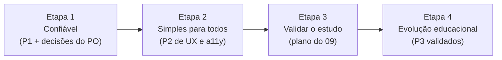

# 20 · Roadmap de produto

Princípio (13): **consolidar antes de crescer**. Cada etapa tem um critério de saída observável. O roadmap não se mede por número de funcionalidades.

## Etapa 1 · Confiável (próximas 2–3 semanas)

- Fazer o merge desta branch, depois de revisar (correções L1–L15).
- Decisões do PO: S-01/ADR-007, regra da leitura na 2ª semana (P1-04), push restrito a hosts conhecidos (P1-10).
- Confirmar o limite de tempo do FrankenPHP (P1-05).
- Validação de domingo no back-end (P1-08) e o teste de concorrência (P1-07).

**Saída:** nenhum erro 500 de validação conhecido, nenhuma falha silenciosa ao salvar e S-01 fechado ou aceito por escrito.

## Etapa 2 · Simples para todos (1 mês)

- Confirmação ao publicar, erros de formulário acessíveis, alvos de 44 px, estouro do progresso e mensagens offline (P2-01 a P2-06).
- Teste com dois ou três alunos idosos de verdade, com o roteiro do 12, no celular deles e com a fonte deles.

**Saída:** um aluno idoso faz sozinho: abrir o link → ler a lição da semana → marcar a leitura.

## Etapa 3 · Validar o estudo (4 domingos)

Plano em 09: o que medir (preparação antes do domingo, retomada das anotações, perguntas levadas à aula), com quem (uma classe, com o consentimento dela) e como (conversa com o professor, não ranking). Rodar o `ai-eval/` uma vez, com autorização de custo.

**Saída:** decidir com evidência quais P3 valem o esforço.

## Etapa 4 · Evolução educacional

Os P3 que passarem na etapa 3, um por vez.

## Fora do roadmap

- Multi-igreja (ADR-004).
- Ranking ou competição entre alunos.
- A IA respondendo por conta própria sobre doutrina ou tomando decisões pastorais.
